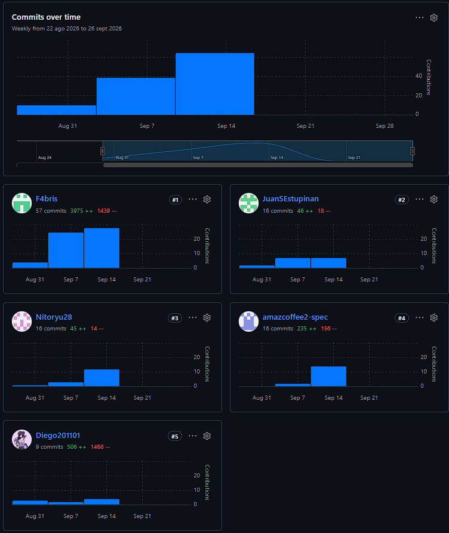
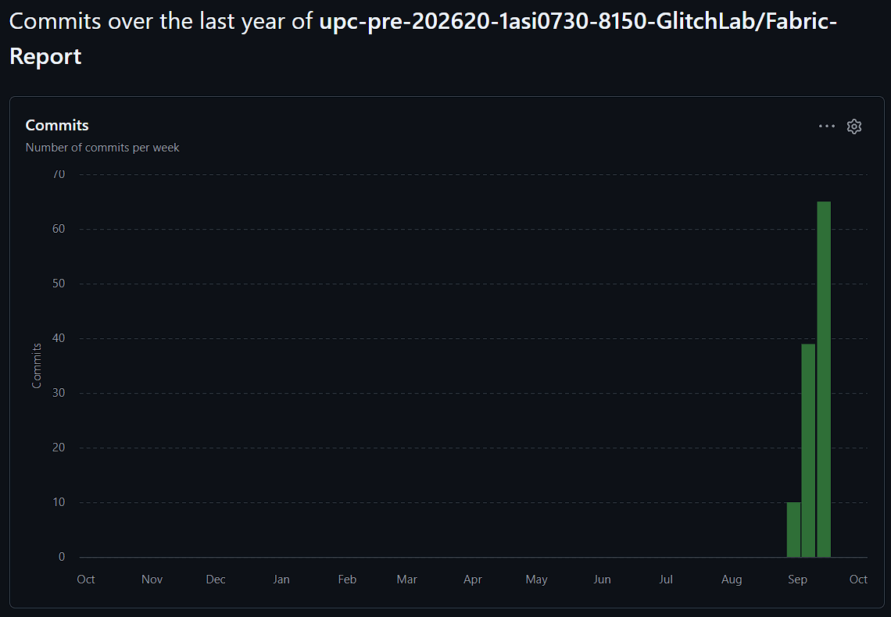
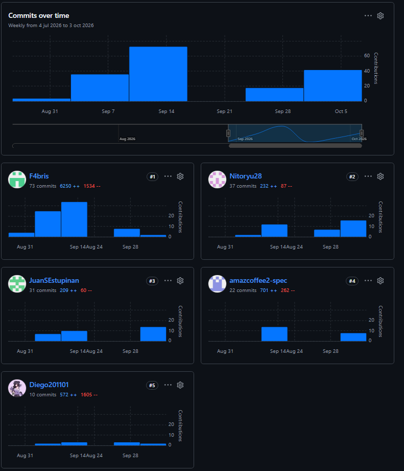
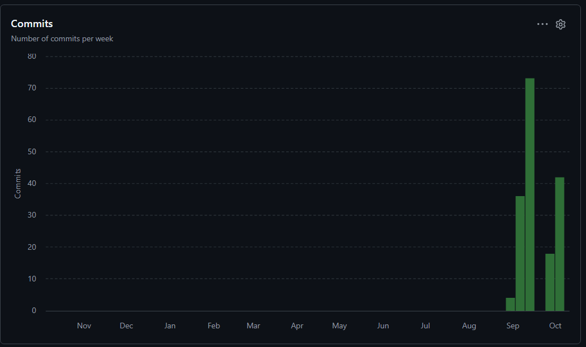
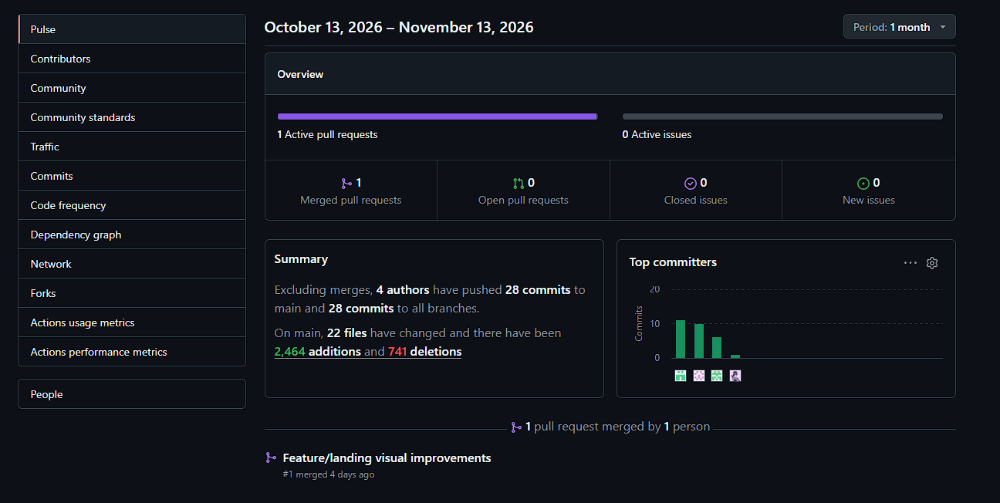
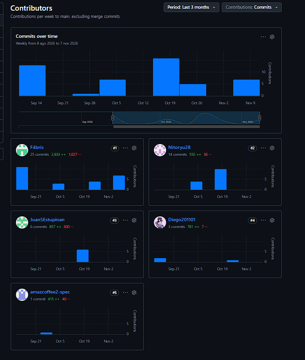
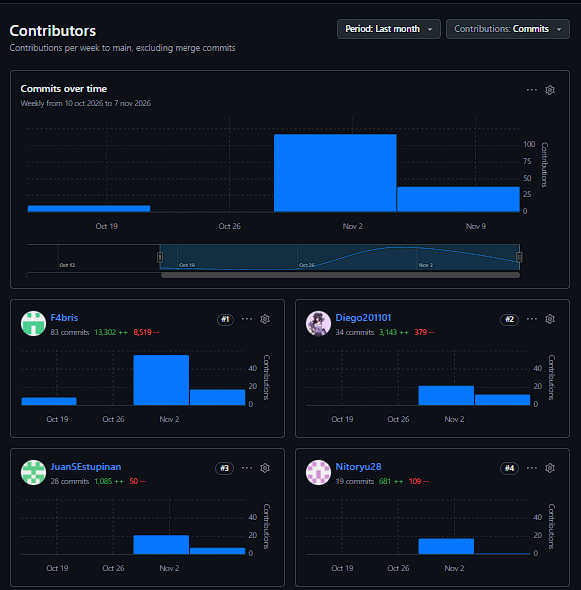
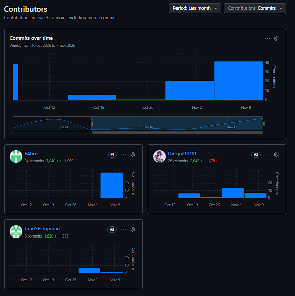
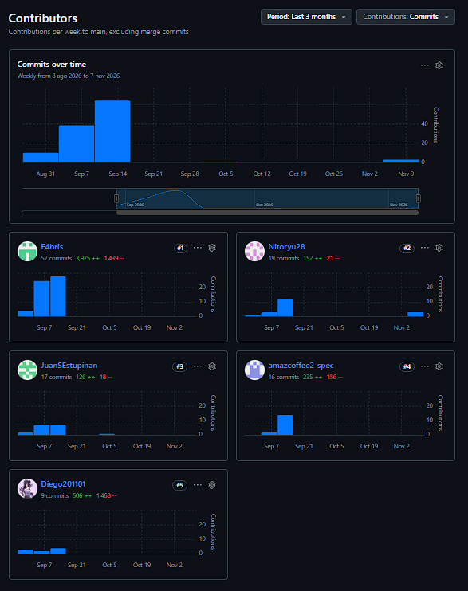

# **Project Report Collaborations Insights**

Nuestro proyecto fue hecho en el repositorio "Fabric-report" dentro de la organización "upc-pre-202620-1asi0730-8150-GlitchLab".

**Enlaze de la organización en GitHub:** https://github.com/upc-pre-202620-1asi0730-8150-GlitchLab

**Enlaze del repositorio:** https://github.com/upc-pre-202620-1asi0730-8150-GlitchLab/Fabric-Report.git

# Avance 1 

Para la entrega del avance 1, se procede a mostrar el análisis de colaboración, el cual representa el número de contribuciones realizadas en el repositorio del informe.

    

 

La siguiente imagen representa todos los commits realizados en el repositorio a lo largo del mes de setiembre.

    

 
 

# Trabajo Parcial (TB1)

Para la entrega del Trabajo 1, se procede a mostrar el análisis de colaboración, el cual representa el número de contribuciones realizadas en el repositorio del informe.

    

 

La siguiente imagen representa todos los commits realizados en el repositorio a lo largo del mes.

    

 
 

# Avance 2

Para la entrega del avance 2, se procede a mostrar el análisis de colaboración, el cual representa el número de contribuciones realizadas en el repositorio del informe, web aplication , web site y platform RESTFUL api.

**Commits del repositorio de la web site**

    

    

 

**Commits del repositorio de Fabric Platform**

    

 

**Commits del repositorio de la Web application**

    

 

**Commits del repositorio del Reporte**

    

