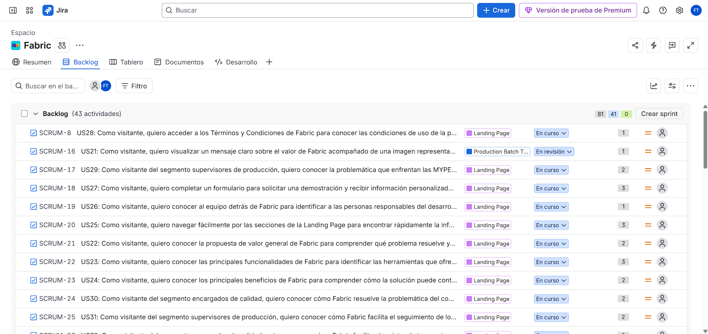

### 3.3. Product Backlog

| N° de Orden (Rank) | Story ID | Título | Descripción | Story Points (1 / 2 / 3 / 5 / 8) |
| :---: | :---: | :--- | :--- | :---: |
| 1 | US021 | Visualización de Hero Section | Como visitante, quiero visualizar un mensaje claro sobre el valor de Fabric acompañado de una imagen representativa para comprender rápidamente qué ofrece la solución. | 1 |
| 2 | US022 | Visualización de la propuesta de valor general | Como visitante, quiero conocer la propuesta de valor general de Fabric para comprender qué problema resuelve y a quién está dirigida la solución. | 2 |
| 3 | US023 | Visualización de funcionalidades | Como visitante, quiero conocer las principales funcionalidades de Fabric para identificar las herramientas que ofrece la plataforma para la gestión de los procesos textiles. | 3 |
| 4 | US024 | Visualización de beneficios | Como visitante, quiero conocer los principales beneficios de Fabric para comprender cómo la solución puede contribuir a la gestión de una empresa textil. | 2 |
| 5 | US025 | Navegación por la Landing Page | Como visitante, quiero navegar fácilmente por las secciones de la Landing Page para encontrar rápidamente la información que deseo conocer sobre Fabric. | 3 |
| 6 | US026 | Visualización del equipo | Como visitante, quiero conocer al equipo detrás de Fabric para identificar a las personas responsables del desarrollo de la solución. | 1 |
| 7 | US027 | Envío de formulario de solicitud de demo | Como visitante, quiero completar un formulario para solicitar una demostración y recibir información personalizada sobre Fabric. | 3 |
| 8 | US028 | Acceso a Términos y Condiciones | Como visitante, quiero acceder a los Términos y Condiciones de Fabric para conocer las condiciones de uso de la plataforma. | 1 |
| 9 | US029 | Visualización de la sección de problema para el segmento supervisores de producción | Como visitante del segmento supervisores de producción, quiero conocer la problemática que enfrentan las MYPE textiles en el seguimiento de producción para entender por qué Fabric es una solución relevante para mi rol. | 2 |
| 10 | US030 | Visualización de la sección de solución para el segmento encargados de calidad | Como visitante del segmento encargados de calidad, quiero conocer cómo Fabric resuelve la problemática del control de calidad en el sector textil para evaluar si la plataforma se adapta a mi rol. | 2 |
| 11 | US031 | Visualización de la Landing Page para el segmento supervisores de producción | Como visitante del segmento supervisores de producción, quiero conocer cómo Fabric facilita el seguimiento de lotes y la detección de retrasos para evaluar si la plataforma se adapta a mi rol. | 2 |
| 12 | US032 | Visualización de la Landing Page para el segmento encargados de calidad | Como visitante del segmento encargados de calidad, quiero conocer cómo Fabric facilita el registro de inspecciones y la identificación de defectos para evaluar si la plataforma se adapta a mi rol. | 2 |
| 13 | US033 | Visualización de la Landing Page para el segmento dueños de MYPE | Como visitante del segmento dueños de MYPE, quiero conocer cómo Fabric contribuye a reducir costos operativos y mejorar la toma de decisiones para evaluar si la plataforma se adapta a mi negocio. | 2 |
| 14 | US034 | Solicitud de demo desde el CTA final | Como visitante, quiero acceder al formulario de solicitud de demo desde el CTA final de la Landing Page para iniciar el contacto con el equipo de Fabric. | 1 |
| 15 | US035 | Visualización de video about the product | Como visitante, quiero visualizar un video demostrativo de Fabric para comprender de forma rápida y visual cómo funciona la plataforma en un contexto real de taller textil. | 3 |
| 16 | US036 | Soporte de internacionalización | Como visitante, quiero que la Landing Page esté disponible en idiomas como inglés y español, teniendo el idioma inglés por defecto, para comprender el contenido de Fabric en el idioma que mejor manejo. | 5 |
| 17 | US001 | Creación y asignación de ID a lote de producción | Como supervisor, quiero crear un nuevo lote de producción ingresando el mod8lo de prenda, cantidad proyectada y ficha técnica para asignarle un ID único y dar inicio a su trazabilidad en el taller. | 5 |
| 18 | US002 | Actualización y transición de etapas operativas del lote | Como supervisor de producción, quiero registrar la transición del lote entre etapas indicando las cantidades procesadas para monitorear el avance real y detectar retenciones. | 5 |
| 19 | US040 | Asignación de operarios a lotes de producción | Como supervisor de producción, quiero asignar operarios a un lote específico indicando la etapa del proceso para registrar responsabilidades y facilitar la trazabilidad. | 2 |
| 20 | US003 | Registro e inspección inicial de rollos de tela entrantes | Como inspector de calidad, quiero registrar los datos de cada rollo de tela recibido para verificar su conformidad inicial antes de autorizar su tendido en la mesa de corte. | 3 |
| 21 | US004 | Registro de prueba de encogimiento y lavado de muestra de tela | Como supervisor de calidad, quiero registrar los resultados de las pruebas de encogimiento porcentual de una muestra de tejido para asegurar que cumple con las tolerancias de la ficha técnica antes de cortar. | 3 |
| 22 | US005 | Registro y clasificación de defectos en prendas confeccionadas | Como auditor de calidad, quiero registrar las prendas con fallas detectadas en línea vinculándolas al lote y máquina responsable para identificar rápidamente la causa del defecto. | 5 |
| 23 | US006 | Destino de prendas defectuosas a reproceso o merma definitiva | Como supervisor de calidad, quiero dictaminar si una prenda observada puede ser reparada o queda para descarte para cuantificar los costos de corrección y ajustar la liquidación final del lote. | 3 |
| 24 | US007 | Reporte de averías e interrupción operativa de máquinas de confección | Como supervisor de producción, quiero registrar la detención de una máquina de coser especificando el código de máquina, tipo de falla y hora de paro para solicitar asistencia técnica inmediata. | 2 |
| 25 | US008 | Reanudación de operatividad y registro del tiempo muerto de máquina | Como supervisor, quiero registrar la reanudación de actividades de una máquina intervenida indicando las piezas sustituidas o calibradas para calcular el tiempo muerto acumulado y evaluar el rendimiento mecánico. | 3 |
| 26 | US011 | Consulta del historial de trazabilidad del lote | Como supervisor de producción, quiero consultar el historial de movimientos de un lote junto con las fechas, cantidades y responsables involucrados, para identificar dónde y cuándo se produce una diferencia durante el proceso productivo. | 3 |
| 27 | US012 | Búsqueda y filtrado de lotes de producción | Como supervisor de producción, quiero buscar y filtrar los lotes registrados por diferentes criterios para localizar rápidamente una orden específica y revisar su información operativa. | 3 |
| 28 | US013 | Registro de resultados y parámetros de inspección del rollo | Como inspector de calidad, quiero registrar los parámetros evaluados durante la inspección de un rollo de tela para conservar evidencia de las condiciones en las que fue recibido el material. | 2 |
| 29 | US014 | Consulta de resultados históricos de inspecciones de tela | Como supervisor de calidad, quiero consultar los resultados históricos de las inspecciones realizadas a los rollos de tela para identificar materiales que presentan problemas recurrentes. | 3 |
| 30 | US015 | Asociación de evidencias a defectos de calidad | Como auditor de calidad, quiero asociar evidencias a los defectos encontrados en las prendas para facilitar su revisión y respaldar las acciones correctivas tomadas. | 3 |
| 31 | US016 | Identificación de defectos recurrentes por lote y máquina | Como supervisor de calidad, quiero consultar los defectos registrados agrupados por tipo, lote y máquina para identificar patrones recurrentes y priorizar acciones correctivas. | 5 |
| 32 | US017 | Consulta del estado actual de las máquinas de confección | Como supervisor de producción, quiero consultar el estado operativo de las máquinas de confección para identificar cuáles se encuentran disponibles, detenidas o en mantenimiento. | 2 |
| 33 | US018 | Registro y consulta del historial de mantenimiento | Como supervisor de producción, quiero registrar y consultar los mantenimientos realizados a cada máquina para conocer las intervenciones efectuadas y apoyar la planificación del mantenimiento preventivo. | 3 |
| 34 | US041 | Registro de observaciones en lote | Como supervisor de producción, quiero registrar observaciones o notas en un lote durante su proceso para documentar incidencias o acuerdos que no corresponden a un defecto formal. | 2 |
| 35 | US009 | Visualización de métricas de avance y productividad diaria en Dashboard | Como administrador del taller o supervisor general, quiero visualizar en un panel centralizado las prendas producidas por hora, el avance de lotes y el porcentaje de cumplimiento diario para tomar decisiones operativas sin recurrir a cuadernos o conteos físicos. | 5 |
| 36 | US010 | Alertas visuales de mermas y cuellos de botella | Como supervisor de planta, quiero recibir alertas cuando la tasa de reprocesos, mermas o tiempos muertos supere los umbrales de tolerancia para intervenir a tiempo en la línea productiva. | 3 |
| 37 | US019 | Visualización de indicadores de defectos, reprocesos y merma | Como supervisor de calidad, quiero consultar indicadores relacionados con defectos, reprocesos y merma para evaluar el comportamiento de la calidad de los lotes y detectar áreas que requieren atención. | 5 |
| 38 | US020 | Generación de alertas por acumulación de tiempo muerto | Como supervisor de producción, quiero recibir alertas cuando una máquina acumule un tiempo muerto superior al límite establecido para identificar posibles problemas recurrentes y tomar acciones preventivas. | 3 |
| 39 | US042 | Exportación de reportes de producción y calidad | Como supervisor o dueño de MYPE, quiero exportar reportes de producción y calidad en formato PDF o Excel para compartirlos con otros responsables o conservarlos como respaldo. | 5 |
| 40 | US037 | Registro de nuevo usuario en la aplicación | Como usuario nuevo, quiero registrarme en Fabric proporcionando mis datos básicos y el rol que desempeño en el taller para acceder a las funcionalidades correspondientes a mi perfil. | 3 |
| 41 | US038 | Inicio de sesión de usuario registrado | Como usuario registrado, quiero iniciar sesión con mis credenciales para acceder a las funcionalidades de Fabric según mi rol. | 3 |
| 42 | US039 | Cierre de sesión de usuario autenticado | Como usuario registrado, quiero cerrar sesión de forma segura para evitar que terceros accedan a mi cuenta en el mismo dispositivo. | 1 |
| 43 | US043 | Actualización de datos del perfil del usuario | Como usuario registrado, quiero actualizar mis datos personales (nombre, teléfono y rol) para mantener mi información vigente en el sistema. | 2 |
| 44 | TS006 | API para gestión de usuarios | Como Developer, quiero disponer de endpoints REST para gestionar los datos de los usuarios para que la plataforma pueda registrar, consultar y actualizar la información necesaria de cada usuario. | 2 |
| 45 | TS001 | API para gestión de lotes de producción | Como Developer, quiero disponer de endpoints REST para gestionar los lotes de producción para que la plataforma pueda registrar y consultar la información de los lotes. | 3 |
| 46 | TS017 | Servicio para búsqueda multicriterio, filtrado y paginación de lotes de producción | Como Developer, quiero disponer de endpoints REST con soporte de paginación, ordenamiento y parámetros de consulta combinados, para que el frontend liste y localice lotes de producción de manera eficiente sin degradar el rendimiento del taller. | 3 |
| 47 | TS009 | Servicio para trazabilidad y cambios de etapa de lotes de producción | Como Developer, quiero disponer de endpoints REST para registrar las transiciones de etapa de los lotes y sus movimientos de trazabilidad, para que la plataforma actualice el avance y controlen las diferencias de prendas entre etapas. | 5 |
| 48 | TS007 | Servicio de gestión y asignación de operarios en lotes de producción | Como Developer, quiero disponer de endpoints REST para registrar y consultar los operarios asignados a cada etapa de un lote, para que la plataforma gestione la trazabilidad del personal en el taller. | 2 |
| 49 | TS008 | Servicio para registro e historial de observaciones de lote | Como Developer, quiero disponer de endpoints REST para registrar y consultar notas operativas asociadas a un lote, para que la plataforma documente incidencias y acuerdos de producción sin alterar el flujo formal de defectos. | 2 |
| 50 | TS004 | API para gestión de maquinaria | Como Developer, quiero disponer de endpoints REST para gestionar la información y estado de las máquinas para que la plataforma pueda registrar y consultar su condición operativa. | 2 |
| 51 | TS010 | Servicio para registro de paradas y tiempos muertos de máquinas | Como Developer, quiero disponer de endpoints REST para registrar eventos de parada de maquinaria y calcular los tiempos muertos, para que la plataforma monitoree la disponibilidad operativa del taller. | 3 |
| 52 | TS016 | Servicio para registro y consulta del historial de mantenimiento de maquinaria | Como Developer, quiero disponer de endpoints REST para registrar intervenciones preventivas o correctivas en máquinas y consultar su historial, para conservar la bitácora técnica de los equipos del taller. | 3 |
| 53 | TS019 | Servicio para registro de rollos de tela y control de disponibilidad para corte | Como Developer, quiero disponer de endpoints REST para registrar los rollos de tela recibidos y definir su condición inicial, para que la plataforma distinga los rollos disponibles para corte de los observados. | 2 |
| 54 | TS015 | Servicio para registro y cálculo de porcentaje de encogimiento en muestras textiles | Como Developer, quiero disponer de endpoints REST para registrar dimensiones de probetas y calcular el porcentaje de encogimiento, para determinar si un rollo cumple la tolerancia técnica antes de autorizar su corte. | 3 |
| 55 | TS020 | Servicio para asignación de rollos de tela a lotes de corte | Como Developer, quiero disponer de endpoints REST para asignar rollos de tela a un lote de producción, para que la plataforma garantice que solo se utilicen rollos habilitados en el tendido y corte. | 3 |
| 56 | TS002 | API para gestión de inspecciones de calidad | Como Developer, quiero disponer de endpoints REST para gestionar las inspecciones de calidad para que la plataforma pueda registrar y consultar los resultados de las inspecciones realizadas. | 2 |
| 57 | TS003 | API para gestión de defectos de calidad | Como Developer, quiero disponer de endpoints REST para gestionar los defectos detectados en las prendas para que la plataforma pueda registrar y consultar las incidencias de calidad. | 3 |
| 58 | TS018 | Servicio para carga y almacenamiento de evidencias fotográficas de defectos | Como Developer, quiero disponer de endpoints REST con soporte multipart/form-data para recibir archivos de imagen vinculados a prendas observadas, para gestionar el almacenamiento y acceso a las evidencias visuales. | 5 |
| 59 | TS011 | Servicio para gestión de evidencias y clasificación de defectos de calidad | Como Developer, quiero disponer de endpoints REST para el registro de defectos y la asociación de evidencias, para que el equipo de calidad clasifique prendas observadas y adjunte respaldo fotográfico. | 3 |
| 60 | TS021 | Servicio para consulta de defectos agrupados por tipo, lote y máquina | Como Developer, quiero disponer de endpoints REST para consultar los defectos registrados de forma agrupada, para que la plataforma permita identificar patrones recurrentes y priorizar acciones correctivas. | 3 |
| 61 | TS022 | Servicio para configuración de umbrales de tolerancia y límites de alerta | Como Developer, quiero disponer de endpoints REST para configurar los umbrales de tolerancia de defectos y de tiempo muerto, para que la plataforma evalúe las alertas de producción con parámetros definidos por el taller. | 3 |
| 19 | TS005 | API para indicadores y alertas | Como Developer, quiero disponer de endpoints REST para consultar indicadores y alertas de producción para que la plataforma pueda utilizar información actualizada en el seguimiento de las operaciones. | 3 |
| 20 | TS012 | Servicio para consultas agregadas y métricas del Dashboard | Como Developer, quiero disponer de endpoints REST para consultar indicadores globales y alertas de producción, para alimentar las tarjetas informativas y gráficos del panel de control principal. | 3 |
| 21 | TS014 | Servicio para exportación y descarga de reportes en PDF y Excel | Como Developer, quiero disponer de endpoints REST que procesen y generen archivos en formato binario, para que la plataforma permita exportar consolidados de producción y calidad según rangos de fecha y lote. | 5 |
| 22 | TS013 | Servicio de autenticación y emisión de tokens de acceso | Como Developer, quiero disponer de endpoints REST para autenticar credenciales y emitir tokens de acceso seguros, para que las aplicaciones cliente gestionen sesiones protegidas según los roles del taller. | 3 |
| 23 | TS023 | Servicio de control de acceso a endpoints según el rol del usuario | Como Developer, quiero disponer de un mecanismo de autorización basado en roles sobre los endpoints REST, para que cada usuario acceda únicamente a los recursos que corresponden a su función dentro del taller. | 3 |
| 24 | TS024 | Servicio de cierre de sesión e invalidación de tokens de acceso | Como Developer, quiero disponer de un endpoint REST para cerrar sesiones activas e invalidar sus tokens, para que las aplicaciones cliente eviten accesos de terceros a una cuenta ya cerrada. | 2 |

 

# Captura de pantalla de Product Backlog hecho en Jira

    

 

**Link de Jira:** https://colmop1548.atlassian.net/jira/software/projects/SCRUM/boards/1/backlog?atlOrigin=eyJpIjoiNzE0ZGM3NTQwYTdmNDY3ZGJlNzBkY2YxNGMzYTZjOWIiLCJwIjoiaiJ9