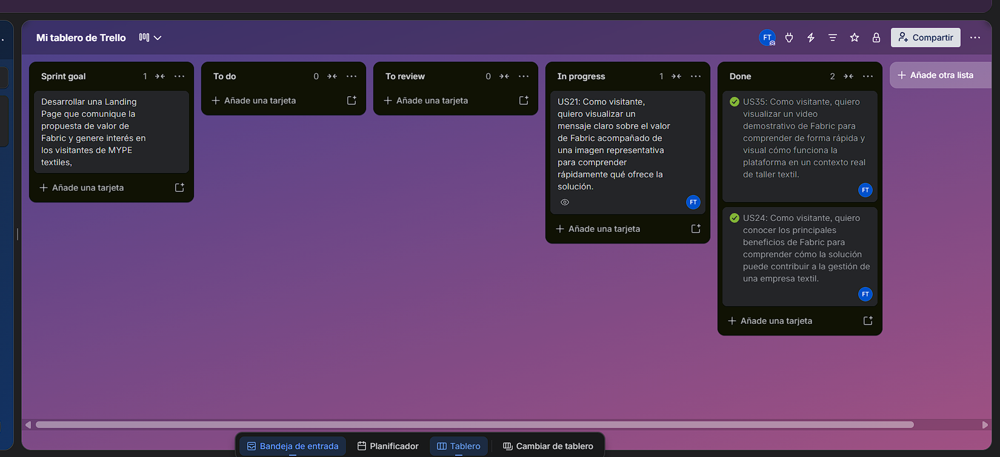

## 5.2. Landing Page, Services & Applications Implementation

### 5.2.1. Sprint 1

Para este primer sprint, nos enfocamos en organizar los requisitos funcionales de la Landing Page. Con el fin de poder asignar a cada miembro del equipo de a 1 a 3 requisitos funcionales para el desarrollo de la landing page.

#### 5.2.1.1. Sprint Planning 1

Durante esta iteración, la reunión de Sprint Planning nos sirve para revisar la velocidad alcanzada en el sprint anterior y establecer los objetivos técnicos de esta nueva etapa. En este espacio, el equipo prioriza las historias de usuario del backlog, calcula el esfuerzo requerido y distribuye las tareas entre los integrantes. La meta es conservar la coordinación del equipo y asegurar que las nuevas funcionalidades se integren sin contratiempos, dejando definido un plan de trabajo claro para el sprint.

| Campo / Sección | Detalle |
| :--- | :--- |
| Sprint # | Sprint 1 |
| Date | 2026-09-11 |
| Time | 7:30 PM |
| Location | Google meet |
| Prepared By | Tello Palacios, Fabrizio Rafael |
| Attendees (to planning meeting) | Silva Hualpa, Rosángela Karen / Flores Martinez, Ricardo Andres / Estupiñan Olortegui, Juan Sebastián / Reátegui Galarcep, Diego Sebastián / Tello Palacios, Fabrizio Rafael |
| Sprint 0 Review Summary | Como se trata del primer sprint del proyecto, no se cuenta con una revisión de una iteración previa. El equipo arrancó a partir de la aprobación del Product Backlog inicial, centrándose en las User Stories de mayor prioridad vinculadas a la Landing Page: propuesta de valor, funcionalidades, beneficios, segmentos objetivo e internacionalización. |
| Sprint 0 Retrospective Summary | Al tratarse también del arranque del proyecto, se definieron las pautas de trabajo del equipo: reuniones de seguimiento diarias (Daily Stand-ups) a través de Meet, el uso de Trello para el control de tareas en los estados To Do, In Process, To Review y Done, y la importancia de mantener una comunicación constante para evitar bloqueos durante el desarrollo de la Landing Page. |
| Sprint 1 Goal | Nuestro enfoque está en desarrollar y desplegar la Landing Page de Fabric, comunicando la propuesta de valor, funcionalidades, beneficios y segmentos objetivo, con diseño responsive y soporte en inglés y español. Creemos que esto permitirá que dueños de MYPE, supervisores de producción y encargados de calidad del sector textil comprendan rápidamente cómo Fabric les ayuda a controlar su producción y calidad. Esto se confirmará cuando los visitantes naveguen por las secciones de la Landing Page desplegada en GitHub Pages, cambien de idioma sin errores y hagan clic en el botón "Start App" para acceder a la aplicación. |
| Sprint 1 Velocity | El equipo ha establecido un Velocity de 30 Story Points, que representa la capacidad máxima de esfuerzo que los developers pueden aceptar de manera realista para este Sprint 1. |
| Sum of Story Points | 27 |

 

#### 5.2.1.2. Aspect Leaders and Collaborators

En esta sección el equipo presenta el artefacto Leadership-and-Collaboration Matrix (LACX) correspondiente al Sprint 1 de Fabric. El objetivo de esta matriz es identificar, para cada aspecto dentro del alcance del Sprint, quién actúa como líder y quiénes como colaboradores, con el fin de brindar mayor claridad y efectividad en la comunicación interna del equipo.

| Team Member (Last Name, First Name) | GitHub Username | UX/UI Design | Landing Page | Documentation | Modeling |
|------------------------------------|----------------|-------------|-------------|--------------|----------|
| Tello Palacios, Fabrizio Rafael | F4bris | C | L | L | L |
| Flores Martinez, Ricardo Andres | Nitoryu28 | C | C | C | C |
| Estupiñan Olortegui, Juan Sebastián	 | JuanSEstupinan | C | L | C | C |
| Reátegui Galarcep, Diego Sebastián | Diego201101 | L | C | C | C |
| Silva Hualpa, Rosangela Karen | amazcofee2-spec | L | C | C | C |

#### 5.2.1.3. Sprint Backlog 1

Nuestro objetivo para este primer sprint fue desarrollar la Landing Page de Fabric, con la intención de comunicar a los visitantes nuestra propuesta de valor de manera simple y precisa. Para ello, las User Stories seleccionadas se descompusieron en Engineering Tasks estimadas entre 4 y 8 horas, con responsable asignado y estado. El seguimiento de las tareas se realizó en Trello mediante los estados To Do, In Process, To Review y Done.

| Sprint # | Sprint 1 | | | | | | |
| :--- | :--- | :--- | :--- | :--- | :---: | :--- | :---: |
| **User Story** | | **Work-Item / Task** | | | | | |
| **Story Id** | **Story Title** | **Task Id** | **Task Title** | **Task Description** | **Estimation (Hours)** | **Assigned To** | **Status** |
| US021 | Visualización de Hero Section | T-01 | Maquetación del Hero Section | Implementar la sección Hero con titular, subtítulo, imagen representativa y botón CTA "Start App", con diseño responsive. | 4 | Estupiñan Olortegui, Juan Sebastian | Done |
| US022 | Visualización de la propuesta de valor general | T-02 | Sección de propuesta de valor | Maquetar el bloque que explica el problema que resuelve Fabric y a quién está dirigida la solución, aplicando la style guide. | 4 | Silva Hualpa, Rosangela Karen | Done |
| US023 | Visualización de funcionalidades | T-03 | Cards de funcionalidades | Desarrollar el grid de cards con íconos y descripción de los módulos de Fabric (lotes, calidad, máquinas, alertas). | 5 | Reátegui Galarcep, Diego Sebastián | Done |
| US024 | Visualización de beneficios | T-04 | Sección de beneficios | Maquetar la sección de beneficios con íconos y textos orientados a la gestión de una empresa textil. | 4 | Flores Martinez, Ricardo Andres | Done |
| US025 | Navegación por la Landing Page | T-05 | Navbar responsive | Implementar barra de navegación con scroll suave hacia cada sección y menú hamburguesa en dispositivos móviles. | 5 | Tello Palacios, Fabrizio Rafael | Done |
| US026 | Visualización del equipo | T-06 | Sección del equipo | Maquetar las cards de los integrantes del equipo con foto, nombre y rol. | 4 | Flores Martinez, Ricardo Andres | Done |
| US028 | Acceso a Términos y Condiciones | T-07 | Vista de Términos y Condiciones | Crear la vista de Términos y Condiciones y enlazarla desde el footer de la Landing Page. | 4 | Silva Hualpa, Rosangela Karen | Done |
| US031 | Visualización de la Landing Page para el segmento supervisores de producción | T-08 | Bloque del segmento supervisores | Maquetar el bloque que muestra cómo Fabric facilita el seguimiento de lotes y la detección de retrasos. | 4 | Reátegui Galarcep, Diego Sebastián | Done |
| US032 | Visualización de la Landing Page para el segmento encargados de calidad | T-09 | Bloque del segmento encargados de calidad | Maquetar el bloque que muestra el registro de inspecciones y la identificación de defectos. | 4 | Flores Martinez, Ricardo Andres | Done |
| US033 | Visualización de la Landing Page para el segmento dueños de MYPE | T-10 | Bloque del segmento dueños de MYPE | Maquetar el bloque que muestra la reducción de costos operativos y la mejora en la toma de decisiones. | 4 | Estupiñan Olortegui, Juan Sebastian | Done |
| US035 | Visualización de video about the product | T-11 | Sección de video del producto | Embeber el video demostrativo de Fabric de forma responsive con portada y controles de reproducción. | 4 | Tello Palacios, Fabrizio Rafael | Done |
| US036 | Soporte de internacionalización | T-12 | Arquitectura i18n | Configurar la estructura de internacionalización con archivos de recursos en/es, inglés por defecto y selector de idioma en la navbar. | 8 | Tello Palacios, Fabrizio Rafael | Done |
|  |  | T-13 | Traducción de contenidos | Traducir y revisar todos los textos de la Landing Page al español y validar el cambio de idioma en todas las secciones. | 4 | Flores Martinez, Ricardo Andres | Done |
|  |  | T-14 | Despliegue en GitHub Pages | Configurar el despliegue de la Landing Page en GitHub Pages desde la rama main y verificar el funcionamiento en producción. | 4 | Estupiñan Olortegui, Juan Sebastian | Done |

A continuación se muestra el tablero de Trello utilizado para el seguimiento de las tareas del Sprint 1:

    

Link del tablero de Trello: <!-- TODO: pegar link del tablero de Trello -->

### 5.2.2. Sprint 2

Para el segundo sprint, el equipo se enfocó en construir el frontend de la aplicación web de Fabric con Vue, implementando las funcionalidades core del negocio en los bounded contexts de Production Tracking, Quality Management y Machine Registry, consumiendo una API simulada con json-server.

#### 5.2.2.1. Sprint Planning 2

Durante la sesión de planificación del Sprint 2, el equipo evaluó los resultados y lecciones aprendidas del Sprint 1 para dimensionar adecuadamente la capacidad de trabajo. Se priorizaron las User Stories core del negocio según el orden del Product Backlog (gestión de lotes de producción, control de calidad de tela y prendas, y gestión de paradas de máquinas), las cuales se implementaron en el frontend de la aplicación web.

| Campo / Sección | Detalle |
| :--- | :--- |
| Sprint # | Sprint 2 |
| Date | 2026-09-28 |
| Time | 8:00 PM |
| Location | Discord |
| Prepared By | Tello Palacios, Fabrizio Rafael |
| Attendees (to planning meeting) | Silva Hualpa, Rosángela Karen / Flores Martinez, Ricardo Andres / Estupiñan Olortegui, Juan Sebastián / Reátegui Galarcep, Diego Sebastián / Tello Palacios, Fabrizio Rafael |
| Sprint 1 Review Summary | Durante el Sprint 1 se concluyó con éxito el diseño, desarrollo y despliegue continuo de la Landing Page pública de Fabric en GitHub Pages, implementando arquitectura i18n, diseño responsive y componentes visuales basados en la style guidelines. El Product Owner validó la presentación de la propuesta de valor dirigida a las MYPE textiles. Se completaron 27 Story Points de los 30 planificados; las observaciones menores sobre ajuste de padding en pantallas ultra-anchas fueron solventadas en la rama develop. |
| Sprint 1 Retrospective Summary | En el Sprint 1 se identificó como acierto la rápida coordinación del prototipo en Figma y el uso de GitFlow y Conventional Commits. Como oportunidad de mejora se detectó que la integración de ramas feature a develop se concentró hacia el final de la iteración, generando merge conflicts. Para el Sprint 2 se acordó descomponer las User Stories en tareas más granulares, realizar pull requests con revisión de código entre pares y sincronizar avances de forma interdiaria. |
| Sprint 2 Goal | Nuestro enfoque está en implementar el frontend de la aplicación web de Fabric con las funcionalidades core del negocio: creación y seguimiento de lotes de producción por etapas, asignación de operarios, inspección de rollos de tela, pruebas de encogimiento, registro y destino de defectos en prendas, y reporte de paradas de máquinas, consumiendo una API simulada con json-server. Creemos que esto permitirá que supervisores de producción y encargados de calidad registren y consulten la información de su planta desde una interfaz clara e intuitiva. Esto se confirmará cuando un usuario pueda crear un lote, avanzarlo de etapa, registrar una inspección de tela y reportar la avería de una máquina desde la aplicación, visualizando los datos persistidos en la API simulada. |
| Sprint 2 Velocity | El equipo estableció un Velocity de 32 Story Points para este Sprint 2. |
| Sum of Story Points | 31 |

 

#### 5.2.2.2. Aspect Leaders and Collaborators

A continuación se presenta la matriz Leadership-and-Collaboration Matrix (LACX) para el Sprint 2 de Fabric. En esta iteración se definieron cinco aspectos clave del frontend de la aplicación web, asignando un rol de Liderazgo (L) y Colaboración (C) a cada miembro del equipo para asegurar la trazabilidad y la responsabilidad:

| Team Member (Last Name, First Name) | GitHub Username | Production Tracking (UI) | Quality Management (UI) | Machine Registry (UI) | Shared / Fake API (Router, Layout, json-server) | Testing & Documentation |
|------------------------------------|----------------|-------------|-------------|--------------|----------|----------|
| Tello Palacios, Fabrizio Rafael | F4bris | C | C | C | L | C |
| Flores Martinez, Ricardo Andres | Nitoryu28 | C | C | C | C | L |
| Estupiñan Olortegui, Juan Sebastián | JuanSEstupinan | L | C | C | C | C |
| Reátegui Galarcep, Diego Sebastián | Diego201101 | C | C | L | C | C |
| Silva Hualpa, Rosangela Karen | amazcofee2-spec | C | L | C | C | C |

#### 5.2.2.3. Sprint Backlog 2

Para el Sprint 2 se seleccionaron 9 User Stories core del negocio del Product Backlog, totalizando 31 Story Points. El trabajo se centró exclusivamente en el frontend de la aplicación web desarrollado en Vue, consumiendo una API simulada con json-server. Las User Stories fueron descompuestas en Engineering Tasks estimadas entre 4 y 8 horas, con responsable asignado y estado. El seguimiento de las tareas se realizó en Jira mediante los estados To Do, In Process, To Review y Done.

| Sprint # | Sprint 2 | | | | | | |
| :--- | :--- | :--- | :--- | :--- | :---: | :--- | :---: |
| **User Story** | | **Work-Item / Task** | | | | | |
| **Story Id** | **Story Title** | **Task Id** | **Task Title** | **Task Description** | **Estimation (Hours)** | **Assigned To** | **Status** |
| US001 | Creación y asignación de ID a lote de producción | T-01 | Configuración de rutas y layout | Configurar Vue Router con las rutas de los bounded contexts y el layout principal con sidebar y toolbar de la aplicación. | 5 | Estupiñan Olortegui, Juan Sebastian | Done |
|  |  | T-02 | Entidad `ProductionBatch` y assembler | Implementar la entidad `ProductionBatch` en la capa de dominio y su assembler para transformar las respuestas de la API simulada. | 4 | Estupiñan Olortegui, Juan Sebastian | Done |
|  |  | T-03 | Servicio API de lotes con json-server | Crear la colección `batches` en `db.json` y el servicio `BatchesApi` con operaciones GET y POST mediante Axios. | 4 | Estupiñan Olortegui, Juan Sebastian | Done |
|  |  | T-04 | Vista de creación de lote | Construir formulario de creación de lote (modelo de prenda, cantidad proyectada, fecha de entrega y ficha técnica) con validaciones y generación de ID con prefijo anual. | 6 | Tello Palacios, Fabrizio Rafael | Done |
|  |  | T-05 | Listado de lotes de producción | Desarrollar la vista de listado de lotes con estado, cantidad y fecha de entrega, y navegación al detalle del lote. | 4 | Flores Martinez, Ricardo Andres | Done |
| US002 | Actualización y transición de etapas operativas del lote | T-06 | Reglas de transición de etapas | Implementar en la entidad del lote la lógica de transición (Corte, Confección, Acabado, Completado) validando que la cantidad procesada no supere la de la etapa previa. | 5 | Estupiñan Olortegui, Juan Sebastian | Done |
|  |  | T-07 | Stepper de etapas en detalle de lote | Desarrollar componente stepper con badges de estado que muestre el avance del lote y permita registrar el cambio de etapa. | 6 | Tello Palacios, Fabrizio Rafael | Done |
|  |  | T-08 | Historial de movimientos del lote | Registrar cada transición como `LotMovement` en la API simulada y mostrar el historial de movimientos en el detalle del lote. | 4 | Flores Martinez, Ricardo Andres | Done |
| US040 | Asignación de operarios a lotes de producción | T-09 | Modal de asignación de operarios | Desarrollar modal para asignar operarios por etapa del lote, validando que un operario no se duplique en la misma etapa. | 5 | Reátegui Galarcep, Diego Sebastián | Done |
| US003 | Registro e inspección inicial de rollos de tela entrantes | T-10 | Entidad `FabricRoll` y servicio API | Implementar la entidad `FabricRoll`, la colección `fabric-rolls` en `db.json` y su servicio API. | 4 | Silva Hualpa, Rosangela Karen | Done |
|  |  | T-11 | Vista de recepción e inspección de rollos | Construir vista para registrar metraje, proveedor, tono y observaciones del rollo, calificándolo como "Disponible para Corte" u "Observado". | 6 | Silva Hualpa, Rosangela Karen | Done |
| US004 | Registro de prueba de encogimiento y lavado de muestra de tela | T-12 | Formulario de prueba de encogimiento | Crear formulario con cálculo automático del porcentaje de variación de urdimbre y trama, marcando "Conforme" si es ≤ 5% y "No Conforme" si lo supera. | 6 | Flores Martinez, Ricardo Andres | Done |
| US005 | Registro y clasificación de defectos en prendas confeccionadas | T-13 | Entidad `Defect` y servicio API | Implementar la entidad `Defect` con tipo, severidad y cantidad, la colección `defects` en `db.json` y su servicio API. | 4 | Silva Hualpa, Rosangela Karen | Done |
|  |  | T-14 | Vista de registro y clasificación de defectos | Desarrollar la vista para registrar defectos por lote y clasificarlos por tipo y severidad, con listado y filtros básicos. | 6 | Tello Palacios, Fabrizio Rafael | Done |
| US006 | Destino de prendas defectuosas a reproceso o merma definitiva | T-15 | Flujo de destino de prendas defectuosas | Implementar acción para enviar prendas defectuosas a reproceso o merma definitiva, actualizando las cantidades del lote en la API simulada. | 5 | Flores Martinez, Ricardo Andres | Done |
| US007 | Reporte de averías e interrupción operativa de máquinas de confección | T-16 | Entidad `Machine` y listado de máquinas | Implementar la entidad `Machine`, la colección `machines` en `db.json` y la vista de listado con tipo y estado operativo. | 5 | Reátegui Galarcep, Diego Sebastián | Done |
|  |  | T-17 | Modal de reporte de avería | Desarrollar modal para reportar la parada de una máquina seleccionando tipo de falla (aguja, motor, tensión) y cambiar su estado a "En Mantenimiento". | 4 | Reátegui Galarcep, Diego Sebastián | Done |
| US008 | Reanudación de operatividad y registro del tiempo muerto de máquina | T-18 | Reanudación y cálculo de tiempo muerto | Implementar modal de fin de intervención que registra la solución aplicada, cambia el estado a "Operativa" y calcula los minutos de tiempo muerto. | 5 | Reátegui Galarcep, Diego Sebastián | Done |
|  |  | T-19 | Tarjeta de tiempo muerto acumulado | Desarrollar componente que muestre los minutos inactivos acumulados por máquina en la vista de detalle. | 4 | Silva Hualpa, Rosangela Karen | Done |

A continuación se muestra la evolución del tablero de Jira durante el Sprint 2:

<!-- TODO: agregar capturas del board de Jira (inicio, mitad y cierre del sprint)

    

    

-->

Link del tablero de Jira: https://colmop1548.atlassian.net/jira/software/projects/SCRUM/boards/1
