## 5.2. Landing Page, Services & Applications Implementation

### 5.2.1. Sprint 1

Para este primer sprint, nos enfocamos en organizar los requisitos funcionales de la Landing Page. Con el fin de poder asignar a cada miembro del equipo de a 1 a 3 requisitos funcionales para el desarrollo de la landing page.

#### 5.2.1.1. Sprint Planning 1

Durante esta iteración, la reunión de Sprint Planning nos sirve para revisar la velocidad alcanzada en el sprint anterior y establecer los objetivos técnicos de esta nueva etapa. En este espacio, el equipo prioriza las historias de usuario del backlog, calcula el esfuerzo requerido y distribuye las tareas entre los integrantes. La meta es conservar la coordinación del equipo y asegurar que las nuevas funcionalidades se integren sin contratiempos, dejando definido un plan de trabajo claro para el sprint.

| Campo / Sección | Detalle |
| :--- | :--- |
| Sprint # | Sprint 1 |
| Date | 2026-09-11 |
| Time | 7:30 PM |
| Location | Google meet |
| Prepared By | Tello Palacios, Fabrizio Rafael |
| Attendees (to planning meeting) | Silva Hualpa, Rosángela Karen / Flores Martinez, Ricardo Andres / Estupiñan Olortegui, Juan Sebastián / Reátegui Galarcep, Diego Sebastián / Tello Palacios, Fabrizio Rafael |
| Sprint 0 Review Summary | Como se trata del primer sprint del proyecto, no se cuenta con una revisión de una iteración previa. El equipo arrancó a partir de la aprobación del Product Backlog inicial, centrándose en las User Stories de mayor prioridad vinculadas a la Landing Page: propuesta de valor, funcionalidades, beneficios, segmentos objetivo e internacionalización. |
| Sprint 0 Retrospective Summary | Al tratarse también del arranque del proyecto, se definieron las pautas de trabajo del equipo: reuniones de seguimiento diarias (Daily Stand-ups) a través de Meet, el uso de Trello para el control de tareas en los estados To Do, In Process, To Review y Done, y la importancia de mantener una comunicación constante para evitar bloqueos durante el desarrollo de la Landing Page. |
| Sprint 1 Goal | Nuestro enfoque está en desarrollar y desplegar la Landing Page de Fabric, comunicando la propuesta de valor, funcionalidades, beneficios y segmentos objetivo, con diseño responsive y soporte en inglés y español. Creemos que esto permitirá que dueños de MYPE, supervisores de producción y encargados de calidad del sector textil comprendan rápidamente cómo Fabric les ayuda a controlar su producción y calidad. Esto se confirmará cuando los visitantes naveguen por las secciones de la Landing Page desplegada en GitHub Pages, cambien de idioma sin errores y hagan clic en el botón "Start App" para acceder a la aplicación. |
| Sprint 1 Velocity | Establecimos un Velocity de 30 Story Points, que representa la capacidad máxima de esfuerzo que los developers pueden aceptar de manera realista para este Sprint 1. |
| Sum of Story Points | 27 |

 

#### 5.2.1.2. Aspect Leaders and Collaborators

En esta sección el equipo presenta el artefacto Leadership-and-Collaboration Matrix (LACX) correspondiente al Sprint 1 de Fabric. El objetivo de esta matriz es identificar, para cada aspecto dentro del alcance del Sprint, quién actúa como líder y quiénes como colaboradores, con el fin de brindar mayor claridad y efectividad en la comunicación interna del equipo.

| Team Member (Last Name, First Name) | GitHub Username | UX/UI Design | Landing Page | Documentation | Modeling |
|------------------------------------|----------------|-------------|-------------|--------------|----------|
| Tello Palacios, Fabrizio Rafael | F4bris | C | L | L | L |
| Flores Martinez, Ricardo Andres | Nitoryu28 | C | C | C | C |
| Estupiñan Olortegui, Juan Sebastián	 | JuanSEstupinan | C | L | C | C |
| Reátegui Galarcep, Diego Sebastián | Diego201101 | L | C | C | C |
| Silva Hualpa, Rosangela Karen | amazcofee2-spec | L | C | C | C |

#### 5.2.1.3. Sprint Backlog 1

Nuestro objetivo para este primer sprint fue desarrollar la Landing Page de Fabric, con la intención de comunicar a los visitantes nuestra propuesta de valor de manera simple y precisa. Para ello, las User Stories seleccionadas se descompusieron en Engineering Tasks estimadas entre 4 y 8 horas, con responsable asignado y estado. El seguimiento de las tareas se realizó en Trello mediante los estados To Do, In Process, To Review y Done.

| Sprint # | Sprint 1 | | | | | | |
| :--- | :--- | :--- | :--- | :--- | :---: | :--- | :---: |
| **User Story** | | **Work-Item / Task** | | | | | |
| **Story Id** | **Story Title** | **Task Id** | **Task Title** | **Task Description** | **Estimation (Hours)** | **Assigned To** | **Status** |
| US021 | Visualización de Hero Section | T-01 | Maquetación del Hero Section | Implementar la sección Hero con titular, subtítulo, imagen representativa y botón CTA "Start App", con diseño responsive. | 4 | Estupiñan Olortegui, Juan Sebastian | Done |
| US022 | Visualización de la propuesta de valor general | T-02 | Sección de propuesta de valor | Maquetar el bloque que explica el problema que resuelve Fabric y a quién está dirigida la solución, aplicando la style guide. | 4 | Silva Hualpa, Rosangela Karen | Done |
| US023 | Visualización de funcionalidades | T-03 | Cards de funcionalidades | Desarrollar el grid de cards con íconos y descripción de los módulos de Fabric (lotes, calidad, máquinas, alertas). | 5 | Reátegui Galarcep, Diego Sebastián | Done |
| US024 | Visualización de beneficios | T-04 | Sección de beneficios | Maquetar la sección de beneficios con íconos y textos orientados a la gestión de una empresa textil. | 4 | Flores Martinez, Ricardo Andres | Done |
| US025 | Navegación por la Landing Page | T-05 | Navbar responsive | Implementar barra de navegación con scroll suave hacia cada sección y menú hamburguesa en dispositivos móviles. | 5 | Tello Palacios, Fabrizio Rafael | Done |
| US026 | Visualización del equipo | T-06 | Sección del equipo | Maquetar las cards de los integrantes del equipo con foto, nombre y rol. | 4 | Flores Martinez, Ricardo Andres | Done |
| US028 | Acceso a Términos y Condiciones | T-07 | Vista de Términos y Condiciones | Crear la vista de Términos y Condiciones y enlazarla desde el footer de la Landing Page. | 4 | Silva Hualpa, Rosangela Karen | Done |
| US031 | Visualización de la Landing Page para el segmento supervisores de producción | T-08 | Bloque del segmento supervisores | Maquetar el bloque que muestra cómo Fabric facilita el seguimiento de lotes y la detección de retrasos. | 4 | Reátegui Galarcep, Diego Sebastián | Done |
| US032 | Visualización de la Landing Page para el segmento encargados de calidad | T-09 | Bloque del segmento encargados de calidad | Maquetar el bloque que muestra el registro de inspecciones y la identificación de defectos. | 4 | Flores Martinez, Ricardo Andres | Done |
| US033 | Visualización de la Landing Page para el segmento dueños de MYPE | T-10 | Bloque del segmento dueños de MYPE | Maquetar el bloque que muestra la reducción de costos operativos y la mejora en la toma de decisiones. | 4 | Estupiñan Olortegui, Juan Sebastian | Done |
| US035 | Visualización de video about the product | T-11 | Sección de video del producto | Embeber el video demostrativo de Fabric de forma responsive con portada y controles de reproducción. | 4 | Tello Palacios, Fabrizio Rafael | Done |
| US036 | Soporte de internacionalización | T-12 | Arquitectura i18n | Configurar la estructura de internacionalización con archivos de recursos en/es, inglés por defecto y selector de idioma en la navbar. | 8 | Tello Palacios, Fabrizio Rafael | Done |
|  |  | T-13 | Traducción de contenidos | Traducir y revisar todos los textos de la Landing Page al español y validar el cambio de idioma en todas las secciones. | 4 | Flores Martinez, Ricardo Andres | Done |
|  |  | T-14 | Despliegue en GitHub Pages | Configurar el despliegue de la Landing Page en GitHub Pages desde la rama main y verificar el funcionamiento en producción. | 4 | Estupiñan Olortegui, Juan Sebastian | Done |

A continuación se muestra el tablero de Trello utilizado para el seguimiento de las tareas del Sprint 1:

    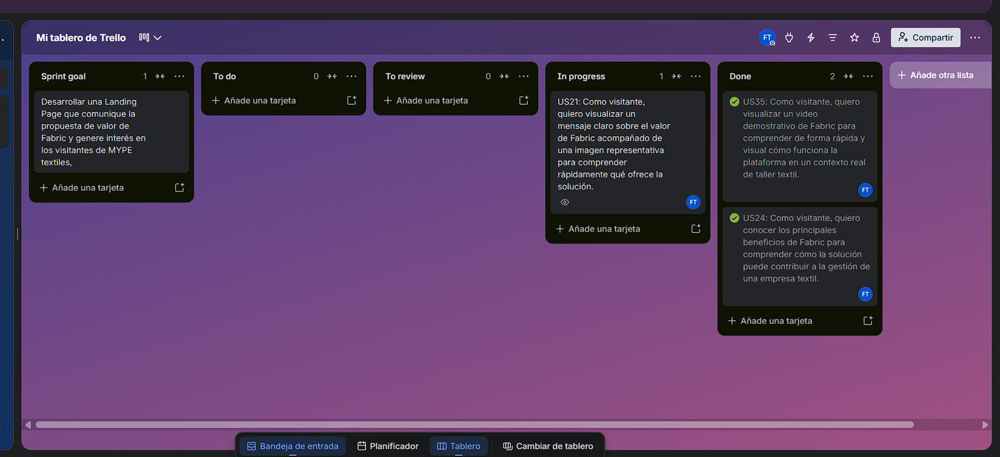

Link del tablero de Trello: [https://shorturl.at/P00iy](https://shorturl.at/P00iy)

#### 5.2.1.4. Development Evidence for Sprint Review

| **Repository** | **Branch** | **Commit Ids** | **Commit Message** | **Commit Message Body** | **Commited On (Date)** |
|----------------|------------|----------------|--------------------|-------------------------|------------------------|
| Fabric-Report | develop | 7bb07cb69ee39ff5a668b4e9dab6d5bb5aa222f4 | docs: refactor user stories table for improved readability and structure |  | 16/09/2026 |
| Fabric-Report | develop | d3cd6e0a6f18167ecc887348ab3117d565b75510 | docs: add wireframes and mockups |  | 16/09/2026 |
| Fabric-Report | develop | df0be0175b3755354fb74678a56caae6e8e864eb | docs: add web wireframe and mockup |  | 16/09/2026 |
| Fabric-Report | develop | 16dbb4d9f890ac7e5bac9f4f850c71bc08668f10 | docs: add prototyping |  | 17/09/2026 |
| Fabric-Report | develop | 9e0edfa28eda616e14f096f63a9a446279b0f2a4 | docs: add diagrams and enhance documentation for Domain-Driven Software Architecture and Software Configuration Management |  | 17/09/2026 |
| Fabric-Report | develop | 524b5a7c51b192687f312ce983afd494f57fccff | feat: add Design-Level Event Storming and Software Architecture diagrams to project report |  | 17/09/2026 |

#### 5.2.1.5. Execution Evidence for Sprint Review

En esta sección se muestran evidencias de la ejecucion de la landing page desarrollada durante el Sprint.

Las capturas presentadas a continuación evidencian la interacción del usuario con las distintas secciones de la landing page, lo que permite verificar la estructura de la información, la propuesta de valor y la navegación establecida para el sistema Fabric.

**Figura 1. Sección principal de la landing page**

En la figura se muestra la sección principal de la landing page, en la cual se expone la propuesta de valor del sistema Fabric, acompañada de un llamado a la acción orientado al usuario.

    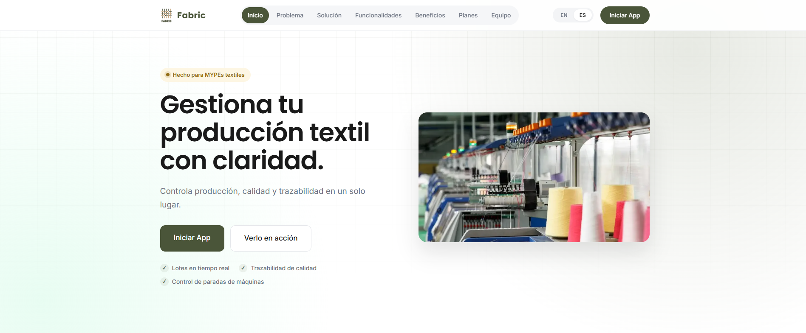

**Figura 2. Sección de solución**

La figura presenta la propuesta de solución que ofrece la plataforma Fabric ante las dificultades operativas del taller textil, organizando la transformación del seguimiento de la producción, el control de calidad y la visibilidad operativa a través de procesos digitales y trazables.

    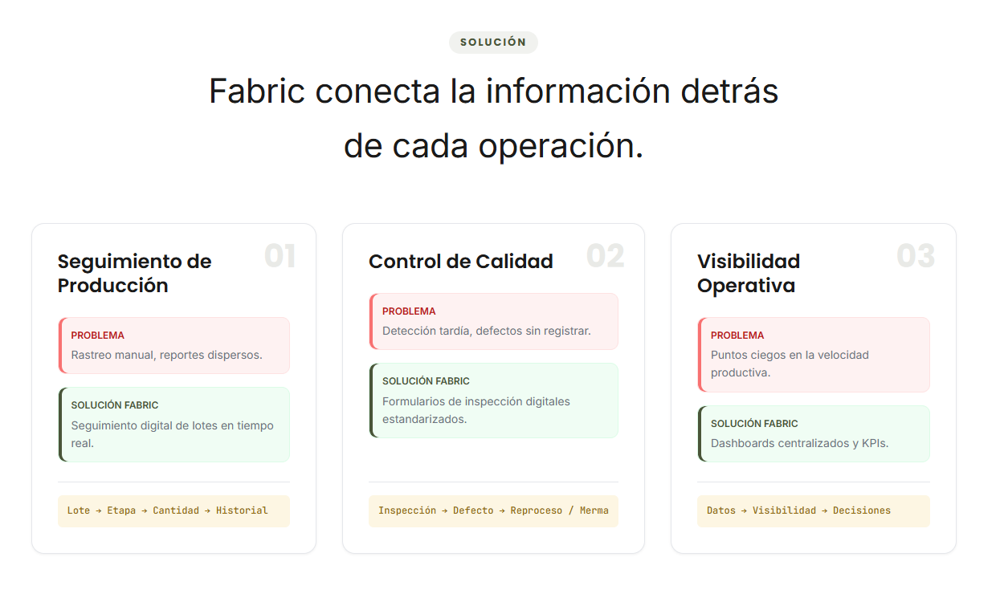

**Figura 3. Sección de funcionalidades y beneficios**

La figura muestra las funcionalidades clave de la plataforma (gestión de lotes, control de calidad, maquinaria y reportes) y sus principales beneficios operativos, como una mayor trazabilidad, un mejor control de los recursos y la centralización digital de la información.

    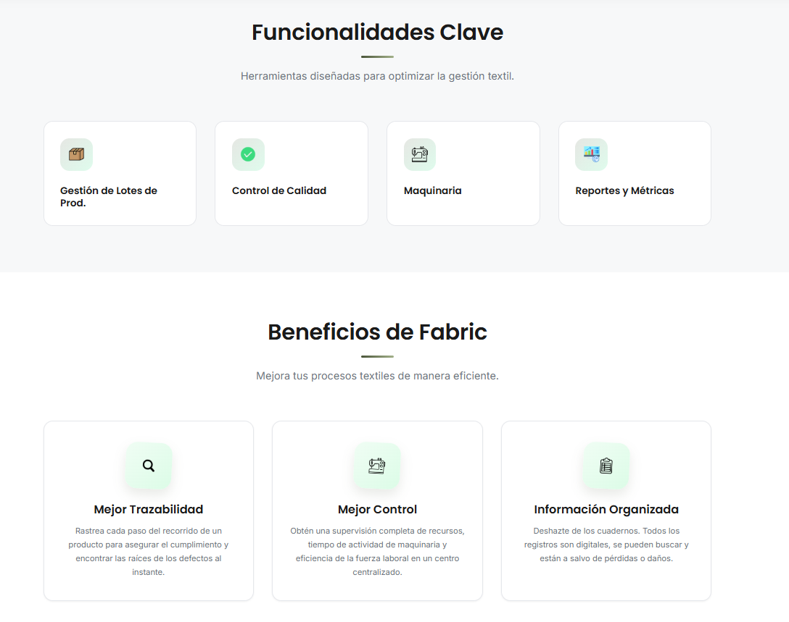

**Figura 4. Sección de evidencia de beneficios**

La figura presenta capturas de los módulos del sistema en funcionamiento (Dashboard, Lotes de Producción, Control de Calidad, Maquinaria y Alertas), lo que evidencia visualmente el control integral y la interfaz intuitiva que la plataforma ofrece para la gestión MYPE.

    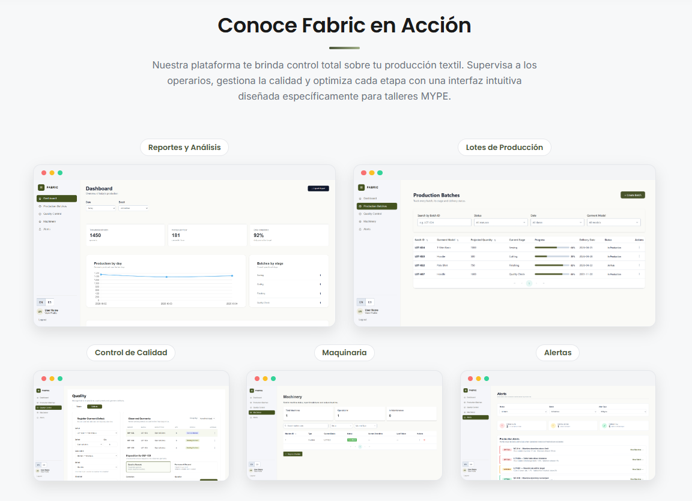

**Figura 5. Sección final y llamado a la acción**

La figura muestra el cierre de la landing page, donde se resaltan las ventajas del servicio junto a un botón destacado de llamado a la acción que invita al usuario a iniciar la aplicación.

    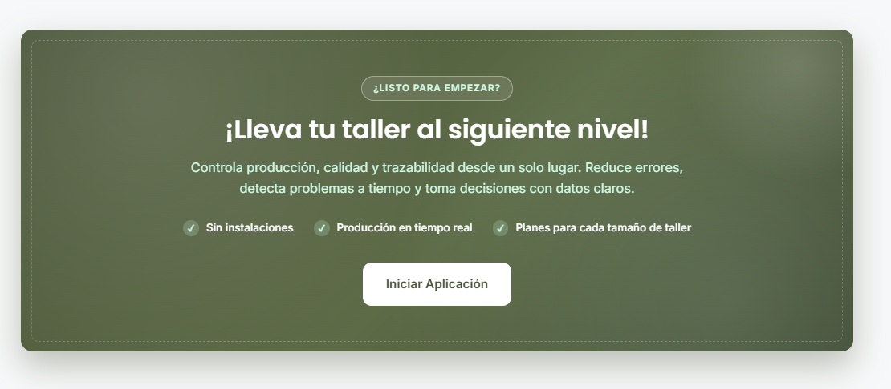

#### 5.2.1.6. Services Documentation Evidence for Sprint Review

Durante el Sprint, el trabajo se orientó principalmente a la creación de la landing page estática y al diseño del prototipo de la aplicación, por lo que todavía no se desarrollaron servicios web ni se elaboró documentación con OpenAPI. En consecuencia, esta fase aún no incluye documentación de Web Services, dado que dichos elementos están previstos para Sprints posteriores, en los cuales se llevará a cabo la implementación técnica del sistema y la integración de los servicios backend.

#### 5.2.1.7. Software Deployment Documentation Evidence for Sprint Review

Este apartado fue omitido deliberadamente en la entrega, devido a que el desarrollo de esta etapa se limitó exclusivamente al diseño de la Landing Page. La descripción detallada de la aplicación se incorporará en las entregas siguientes, conforme avance el proyecto.

#### 5.2.1.8. Team Collaboration Insights During Sprint

Para el desarrollo del primer sprint, todos los miembros del equipo colaboraros de forma activa y constante. De esta manera, se muestra como evidencia los insights de cada miembro de equipo.

    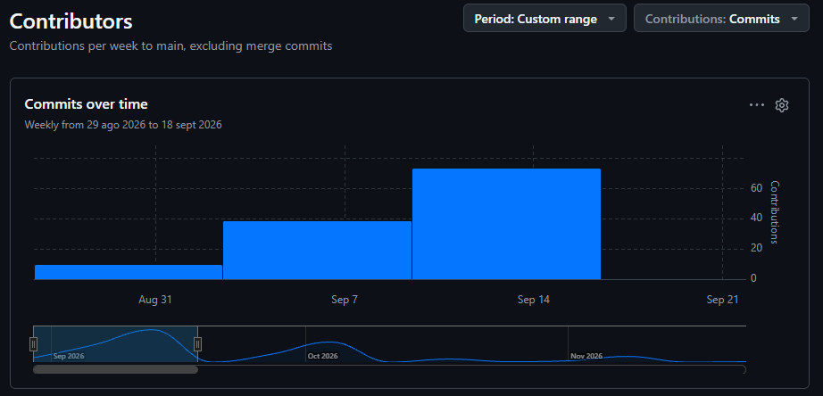
    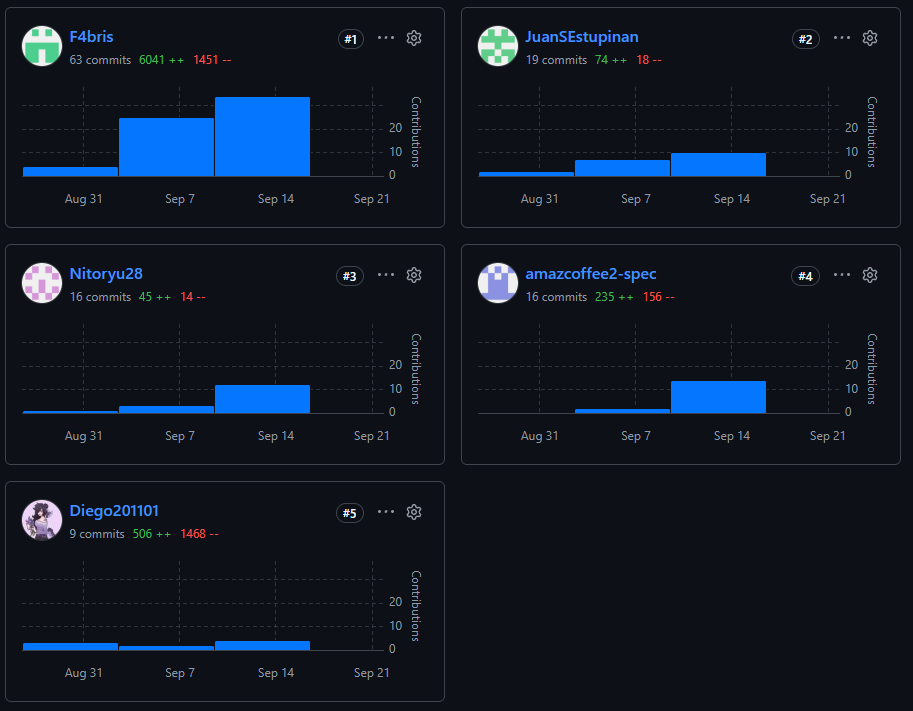

### 5.2.2. Sprint 2

Para el segundo sprint, el equipo se enfocó en construir el frontend de la aplicación web de Fabric con Vue, implementando las funcionalidades core del negocio en los bounded contexts de Production Tracking, Quality Management y Machine Registry, consumiendo una API simulada con json-server.

#### 5.2.2.1. Sprint Planning 2

Durante la sesión de planificación del Sprint 2, el equipo evaluó los resultados y lecciones aprendidas del Sprint 1 para dimensionar adecuadamente la capacidad de trabajo. Se priorizaron las User Stories core del negocio según el orden del Product Backlog (gestión de lotes de producción, control de calidad de tela y prendas, y gestión de paradas de máquinas), las cuales se implementaron en el frontend de la aplicación web.

| Campo / Sección | Detalle |
| :--- | :--- |
| Sprint # | Sprint 2 |
| Date | 2026-09-28 |
| Time | 8:00 PM |
| Location | Discord |
| Prepared By | Tello Palacios, Fabrizio Rafael |
| Attendees (to planning meeting) | Silva Hualpa, Rosángela Karen / Flores Martinez, Ricardo Andres / Estupiñan Olortegui, Juan Sebastián / Reátegui Galarcep, Diego Sebastián / Tello Palacios, Fabrizio Rafael |
| Sprint 1 Review Summary | Durante el Sprint 1 se concluyó con éxito el diseño, desarrollo y despliegue continuo de la Landing Page pública de Fabric en GitHub Pages, implementando arquitectura i18n, diseño responsive y componentes visuales basados en la style guidelines. El Product Owner validó la presentación de la propuesta de valor dirigida a las MYPE textiles. Se completaron 27 Story Points de los 30 planificados; las observaciones menores sobre ajuste de padding en pantallas ultra-anchas fueron solventadas en la rama develop. |
| Sprint 1 Retrospective Summary | En el Sprint 1 se identificó como acierto la rápida coordinación del prototipo en Figma y el uso de GitFlow y Conventional Commits. Como oportunidad de mejora se detectó que la integración de ramas feature a develop se concentró hacia el final de la iteración, generando merge conflicts. Para el Sprint 2 se acordó descomponer las User Stories en tareas más granulares, realizar pull requests con revisión de código entre pares y sincronizar avances de forma interdiaria. |
| Sprint 2 Goal | Nuestro enfoque está en implementar el frontend de la aplicación web de Fabric con las funcionalidades core del negocio: creación y seguimiento de lotes de producción por etapas, asignación de operarios, inspección de rollos de tela, pruebas de encogimiento, registro y destino de defectos en prendas, y reporte de paradas de máquinas, consumiendo una API simulada con json-server. Creemos que esto permitirá que supervisores de producción y encargados de calidad registren y consulten la información de su planta desde una interfaz clara e intuitiva. Esto se confirmará cuando un usuario pueda crear un lote, avanzarlo de etapa, registrar una inspección de tela y reportar la avería de una máquina desde la aplicación, visualizando los datos persistidos en la API simulada. |
| Sprint 2 Velocity | El equipo estableció un Velocity de 32 Story Points para este Sprint 2. |
| Sum of Story Points | 31 |

 

#### 5.2.2.2. Aspect Leaders and Collaborators

A continuación se presenta la matriz Leadership-and-Collaboration Matrix (LACX) para el Sprint 2 de Fabric. En esta iteración se definieron cinco aspectos clave del frontend de la aplicación web, asignando un rol de Liderazgo (L) y Colaboración (C) a cada miembro del equipo para asegurar la trazabilidad y la responsabilidad:

| Team Member (Last Name, First Name) | GitHub Username | Production Tracking (UI) | Quality Management (UI) | Machine Registry (UI) | Shared / Fake API (Router, Layout, json-server) | Testing & Documentation |
|------------------------------------|----------------|-------------|-------------|--------------|----------|----------|
| Tello Palacios, Fabrizio Rafael | F4bris | C | C | C | L | C |
| Flores Martinez, Ricardo Andres | Nitoryu28 | C | C | C | C | L |
| Estupiñan Olortegui, Juan Sebastián | JuanSEstupinan | L | C | C | C | C |
| Reátegui Galarcep, Diego Sebastián | Diego201101 | C | C | L | C | C |
| Silva Hualpa, Rosangela Karen | amazcofee2-spec | C | L | C | C | C |

#### 5.2.2.3. Sprint Backlog 2

Para el Sprint 2 se seleccionaron 9 User Stories core del negocio del Product Backlog, totalizando 31 Story Points. El trabajo se centró exclusivamente en el frontend de la aplicación web desarrollado en Vue, consumiendo una API simulada con json-server. Las User Stories fueron descompuestas en Engineering Tasks estimadas entre 4 y 8 horas, con responsable asignado y estado. El seguimiento de las tareas se realizó en Trello mediante los estados To Do, In Process, To Review y Done.

| Sprint # | Sprint 2 | | | | | | |
| :--- | :--- | :--- | :--- | :--- | :---: | :--- | :---: |
| **User Story** | | **Work-Item / Task** | | | | | |
| **Story Id** | **Story Title** | **Task Id** | **Task Title** | **Task Description** | **Estimation (Hours)** | **Assigned To** | **Status** |
| US001 | Creación y asignación de ID a lote de producción | T-01 | Configuración de rutas y layout | Configurar Vue Router con las rutas de los bounded contexts y el layout principal con sidebar y toolbar de la aplicación. | 5 | Estupiñan Olortegui, Juan Sebastian | Done |
|  |  | T-02 | Entidad `ProductionBatch` y assembler | Implementar la entidad `ProductionBatch` en la capa de dominio y su assembler para transformar las respuestas de la API simulada. | 4 | Estupiñan Olortegui, Juan Sebastian | Done |
|  |  | T-03 | Servicio API de lotes con json-server | Crear la colección `batches` en `db.json` y el servicio `BatchesApi` con operaciones GET y POST mediante Axios. | 4 | Estupiñan Olortegui, Juan Sebastian | Done |
|  |  | T-04 | Vista de creación de lote | Construir formulario de creación de lote (modelo de prenda, cantidad proyectada, fecha de entrega y ficha técnica) con validaciones y generación de ID con prefijo anual. | 6 | Tello Palacios, Fabrizio Rafael | Done |
|  |  | T-05 | Listado de lotes de producción | Desarrollar la vista de listado de lotes con estado, cantidad y fecha de entrega, y navegación al detalle del lote. | 4 | Flores Martinez, Ricardo Andres | Done |
| US002 | Actualización y transición de etapas operativas del lote | T-06 | Reglas de transición de etapas | Implementar en la entidad del lote la lógica de transición (Corte, Confección, Acabado, Completado) validando que la cantidad procesada no supere la de la etapa previa. | 5 | Estupiñan Olortegui, Juan Sebastian | Done |
|  |  | T-07 | Stepper de etapas en detalle de lote | Desarrollar componente stepper con badges de estado que muestre el avance del lote y permita registrar el cambio de etapa. | 6 | Tello Palacios, Fabrizio Rafael | Done |
|  |  | T-08 | Historial de movimientos del lote | Registrar cada transición como `LotMovement` en la API simulada y mostrar el historial de movimientos en el detalle del lote. | 4 | Flores Martinez, Ricardo Andres | Done |
| US040 | Asignación de operarios a lotes de producción | T-09 | Modal de asignación de operarios | Desarrollar modal para asignar operarios por etapa del lote, validando que un operario no se duplique en la misma etapa. | 5 | Reátegui Galarcep, Diego Sebastián | Done |
| US003 | Registro e inspección inicial de rollos de tela entrantes | T-10 | Entidad `FabricRoll` y servicio API | Implementar la entidad `FabricRoll`, la colección `fabric-rolls` en `db.json` y su servicio API. | 4 | Silva Hualpa, Rosangela Karen | Done |
|  |  | T-11 | Vista de recepción e inspección de rollos | Construir vista para registrar metraje, proveedor, tono y observaciones del rollo, calificándolo como "Disponible para Corte" u "Observado". | 6 | Silva Hualpa, Rosangela Karen | Done |
| US004 | Registro de prueba de encogimiento y lavado de muestra de tela | T-12 | Formulario de prueba de encogimiento | Crear formulario con cálculo automático del porcentaje de variación de urdimbre y trama, marcando "Conforme" si es ≤ 5% y "No Conforme" si lo supera. | 6 | Flores Martinez, Ricardo Andres | Done |
| US005 | Registro y clasificación de defectos en prendas confeccionadas | T-13 | Entidad `Defect` y servicio API | Implementar la entidad `Defect` con tipo, severidad y cantidad, la colección `defects` en `db.json` y su servicio API. | 4 | Silva Hualpa, Rosangela Karen | Done |
|  |  | T-14 | Vista de registro y clasificación de defectos | Desarrollar la vista para registrar defectos por lote y clasificarlos por tipo y severidad, con listado y filtros básicos. | 6 | Tello Palacios, Fabrizio Rafael | Done |
| US006 | Destino de prendas defectuosas a reproceso o merma definitiva | T-15 | Flujo de destino de prendas defectuosas | Implementar acción para enviar prendas defectuosas a reproceso o merma definitiva, actualizando las cantidades del lote en la API simulada. | 5 | Flores Martinez, Ricardo Andres | Done |
| US007 | Reporte de averías e interrupción operativa de máquinas de confección | T-16 | Entidad `Machine` y listado de máquinas | Implementar la entidad `Machine`, la colección `machines` en `db.json` y la vista de listado con tipo y estado operativo. | 5 | Reátegui Galarcep, Diego Sebastián | Done |
|  |  | T-17 | Modal de reporte de avería | Desarrollar modal para reportar la parada de una máquina seleccionando tipo de falla (aguja, motor, tensión) y cambiar su estado a "En Mantenimiento". | 4 | Reátegui Galarcep, Diego Sebastián | Done |
| US008 | Reanudación de operatividad y registro del tiempo muerto de máquina | T-18 | Reanudación y cálculo de tiempo muerto | Implementar modal de fin de intervención que registra la solución aplicada, cambia el estado a "Operativa" y calcula los minutos de tiempo muerto. | 5 | Reátegui Galarcep, Diego Sebastián | Done |
|  |  | T-19 | Tarjeta de tiempo muerto acumulado | Desarrollar componente que muestre los minutos inactivos acumulados por máquina en la vista de detalle. | 4 | Silva Hualpa, Rosangela Karen | Done |

 

A continuación se muestra la evolución del tablero en Trello durante el Sprint 2:

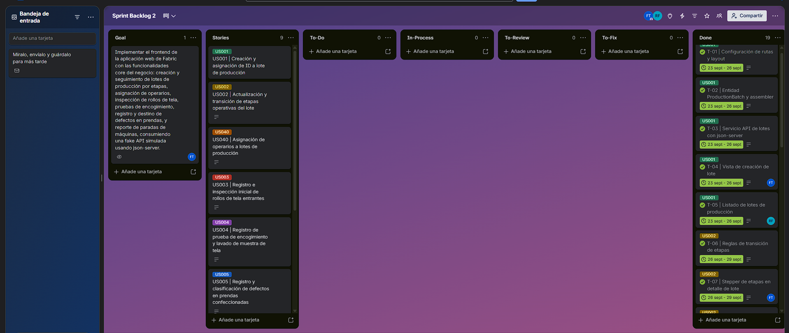

 

Link del tablero de Trello: [https://shorturl.at/xErzZ](https://shorturl.at/xErzZ)

#### 5.2.2.4. Development Evidence for Sprint Review

| **Repository** | **Branch** | **Commit Ids** | **Commit Message** | **Commit Message Body** | **Commited On (Date)** |
|----------------|------------|----------------|--------------------|-------------------------|------------------------|
| Fabric-WebApplication | develop | 836076702791a473e3154322b90f74f808967473 | feat(shared): build sidebar with options using routes and vue components |  | 02/10/2026 |
| Fabric-WebApplication | develop | 2b22b6db5457057f88787386efa519203884b426 | feat(machine-registration): machine-registration main screen with data table, form and list for machines |  | 04/10/2026 |
| Fabric-WebApplication | develop | e533351b8f02cea06d6cc3e000cdefd2ae9220d4 | feat(components): add productionchart component |  | 05/10/2026 |
| Fabric-WebApplication | develop | 1f5ebb9daa5cc9bdf6843cd35293dd9c1afe98d1 | feat(presentation-view): Creating component for home screen of quality module |  | 06/10/2026 |
| Fabric-WebApplication | develop | 3b28326e3ed29fc77dc86f7fa5a776a27133d1bf | feat: putting alerts and dashboard into domain-driven design |  | 06/10/2026 |
| Fabric-WebApplication | develop | 9504b8b0a3ed51372840ea382a2cac77966cb0c1 | feat(server): Correcting and implementing server options for database and new options |  | 06/10/2026 |
| Fabric-WebApplication | develop | d5b20b8769bf7d6633fb9da22cb1cd2cb97c7d6f | feat: added production batches directory, edited main.js and router.js |  | 06/10/2026 |
| Fabric-WebApplication | develop | d709347841982f828e17a1fd5f4b892b875b087e | feat(server): connecting fakeAPI with frontend |  | 06/10/2026 |

#### 5.2.2.5. Execution Evidence for Sprint Review

En esta seccion se presentan evidencias de la implementacion de la aplicación web desarrollada durante el sprint

**Figura 1. Dashboard Principal**

La figura muestra el panel de control general de Fabric, donde se aprecian los indicadores clave de producción diaria (prendas fabricadas, promedio por hora y porcentaje de cumplimiento), el gráfico de producción temporal y el avance por lotes y etapas.

    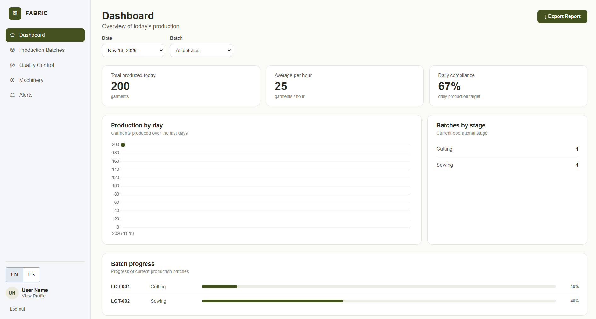

**Figura 2. Sección de Lotes de Producción**

La figura muestra el módulo de gestión de lotes de producción (Production Batches), que permite filtrar y buscar órdenes de trabajo y presenta en una tabla paginada el código del lote, el modelo de prenda, la cantidad proyectada, la etapa actual, el porcentaje de progreso y la fecha de entrega estimada.

    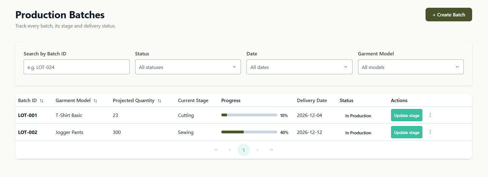

**Figura 3. Sección de Calidad**

La figura muestra la interfaz principal del módulo de control de calidad (Quality), que resume las métricas de rollos registrados, conformes, observados y pruebas pendientes, junto con el listado detallado de inspecciones y sus estados de aprobación y acciones operativas.

    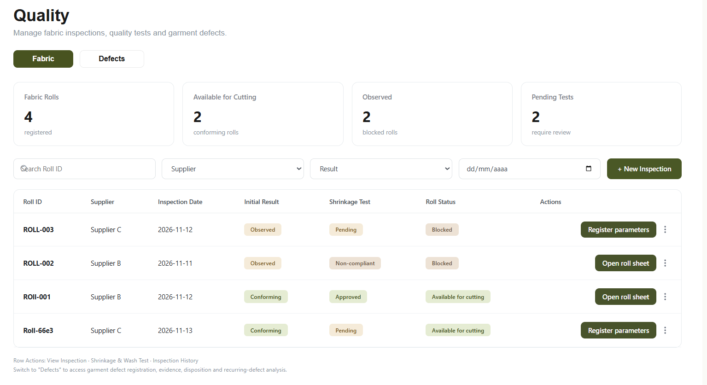

**Figura 4. Sección de Maquinaria**

La figura presenta el panel de monitoreo de maquinaria (Machinery), que centraliza el estado operativo de los equipos del taller (total, en operación o en mantenimiento) y muestra la tabla de control con la ubicación, el tipo de máquina, los tiempos muertos acumulados y el registro de averías.

    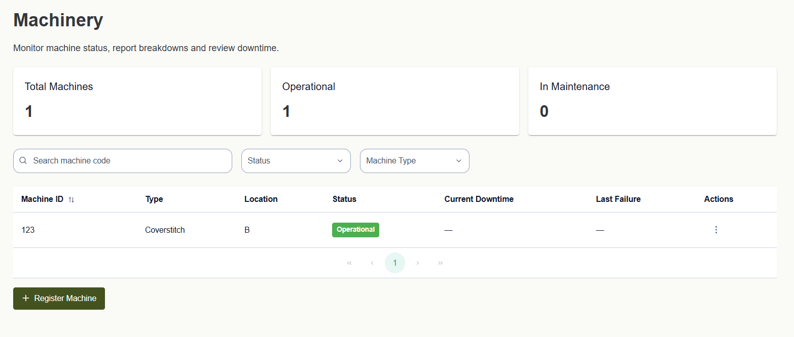

**Figura 5. Sección de Alertas**

La figura muestra el sistema de gestión de alertas de producción (Alerts), que clasifica y notifica automáticamente incidencias críticas, lotes en riesgo de incumplimiento y flujos óptimos de trabajo, mediante filtros por estado, lote y tipo de alerta.

    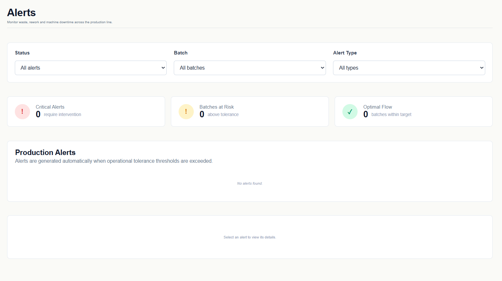

**Figura 6. Sección de Inspección de Rollo**

La figura muestra el formulario de registro e inspección inicial de rollos de tela (New roll inspection), en el que se ingresan los datos de recepción del proveedor (metraje, muestra del cliente y tono) y se evalúa la conformidad del tejido antes de autorizar su pase a corte.

    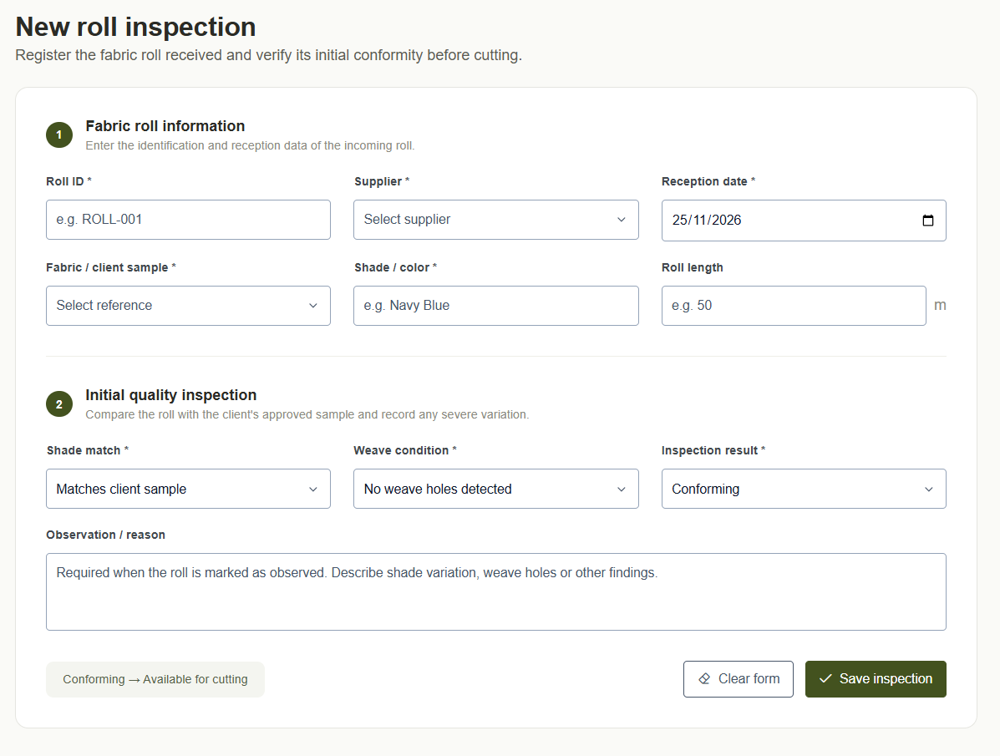

**Figura 7. Parámetros de Inspección**

La figura muestra la vista para el registro de parámetros evaluados durante la inspección técnica (Inspection parameters), que permite capturar datos dimensionales (ancho y largo), variaciones de tono, tipo de defectos detectados y observaciones generales del material recibido.

    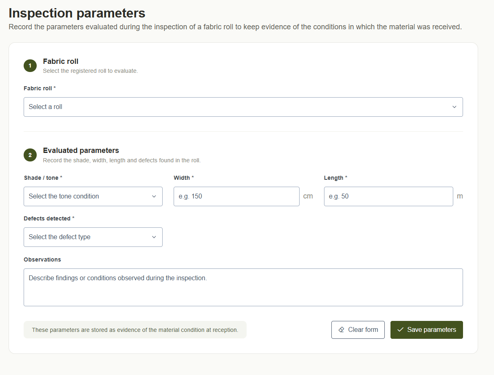

**Figura 8. Prueba de Encogimiento**

La figura presenta la interfaz para la ejecución y el registro de la prueba de encogimiento (Shrinkage test), que permite calcular la variación dimensional de una muestra textil antes y después del lavado, con el fin de validar su cumplimiento con la tolerancia técnica del taller antes del tendido.

    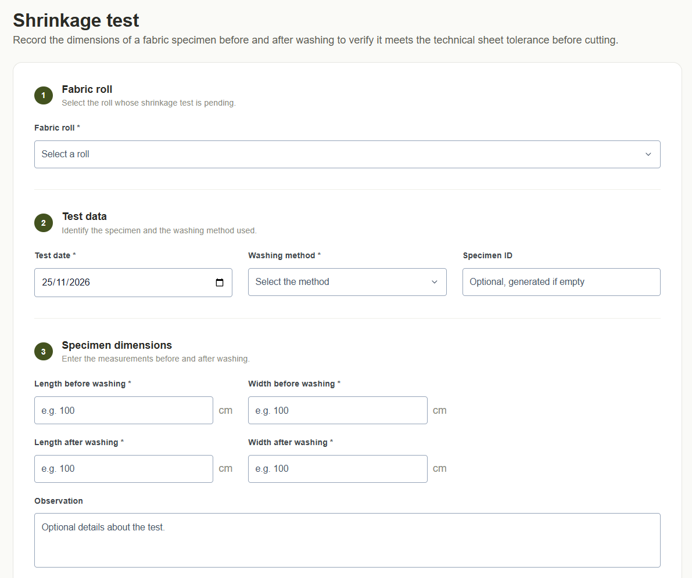

#### 5.2.2.6. Services Documentation Evidence for Sprint Review

Dentro del alcance del presente Sprint 2, el equipo no llevó a cabo la implementación de un Web Service propio que contara con documentación bajo OpenAPI/Scalar, debido a que el backend formal desarrollado en ASP.NET Core está previsto como un entregable posterior (AV2/TB2). No obstante, el frontend de Fabric integró llamadas HTTP para lotes de producción, operarios, trazabilidad, observaciones, maquinaria, alertas, analítica y control de calidad. La aplicación emplea Axios y, en desarrollo, configura la API en http://localhost:3000; el README identifica dicha API como un mock con JSON Server.

**Servicio FakeAPI: `https://fabric-platform.onrender.com/api/v1`**

| **Endpoint** | **Verbo HTTP** | **Descripción** | **Parámetros** | **Ejemplo Respuesta** |
|--------------|----------------|-----------------|----------------|-----------------------|
| `/batches` | GET | Lista los lotes de producción. | Ninguno. | `[{"id":"1","batchNumber":"LOT-024","currentStage":"Sewing","status":"In Production"}]` |
| `/batches` | POST | Crea un lote. | Cuerpo: `garmentModel`, `projectedQuantity`, `deliveryDate`, `notes`. | `{"id":"7","batchNumber":"LOT-029","garmentModel":"Hoodie","projectedQuantity":500}` |
| `/batches/{id}` | GET | Obtiene un lote por identificador. | Ruta: `id`. | `{"id":"1","batchNumber":"LOT-024","currentStage":"Sewing"}` |
| `/batches/{id}` | PUT | Actualiza datos o etapa de un lote. | Ruta: `id`. Cuerpo: campos del lote, como `currentStage` o `processedQuantity`. | `{"id":"1","currentStage":"Finishing","processedQuantity":492}` |
| `/traceabilityHistory/{batchId}` | GET | Obtiene movimientos de trazabilidad asociados a un lote. | Ruta: `batchId`. | `[{"id":"1","batchId":"1","stageName":"Sewing","qtyIn":500,"qtyOut":492}]` |
| `/operators` | GET | Lista los operarios disponibles. | Ninguno. | `[{"id":"1","name":"Carlos Mendoza","specialty":"Overlock"}]` |
| `/assignedOperators/{batchId}` | GET | Consulta las asignaciones de operarios de un lote. | Ruta: `batchId`. | `[{"id":"1","batchId":"1","operatorName":"Carlos Mendoza","stage":"Sewing"}]` |
| `/assignedOperators` | POST | Asigna un operario a un lote. | Cuerpo: `batchId`, `operatorName`, `specialty`, `stage`, `assignedAt`. | `{"id":"2","batchId":"1","operatorName":"Ana Torres","stage":"Sewing"}` |
| `/observations/{batchId}` | GET | Consulta observaciones de un lote. | Ruta: `batchId`. | `[{"id":"1","batchId":"1","authorName":"Rosangela Silva","content":"Producción pausada","createdAt":"16/09/2026"}]` |
| `/observations` | POST | Registra una observación para un lote. | Cuerpo: `batchId`, `timestamp`, `text`, `author`. | `{"id":"2","batchId":"1","text":"Revisión completada","author":"Registered by Supervisor"}` |
| `/machines` | GET | Lista las máquinas. | Ninguno. | `[{"id":"1","type":"overlock","status":"operational","batchId":"LOT-023"}]` |
| `/machines` | POST | Registra una máquina. | Cuerpo: datos de la máquina. | `{"id":"2","type":"overlock","status":"operational"}` |
| `/machines/{id}` | GET | Obtiene una máquina por identificador. | Ruta: `id`. | `{"id":"1","type":"overlock","status":"operational"}` |
| `/machines/{id}/status` | PUT | Actualiza el estado de una máquina. | Ruta: `id`. Cuerpo: nuevo estado. | `{"id":"1","status":"in-maintenance"}` |
| `/machines/{machineId}/downtimes` | GET | Consulta las paradas de una máquina. | Ruta: `machineId`. | `[{"id":"1","machineId":"1","cause":"mechanical-jam","resumedAt":null}]` |
| `/machines/{machineId}/downtimes` | POST | Registra una parada de máquina. | Ruta: `machineId`. Cuerpo: causa, descripción y hora de parada. | `{"id":"2","machineId":"1","cause":"mechanical-jam","stoppedAt":"2026-11-25T10:00:00Z"}` |
| `/machines/{machineId}/downtimes/{downtimeId}/resumption` | PUT | Registra la reanudación de una parada. | Ruta: `machineId`, `downtimeId`. Cuerpo: hora de reanudación. | `{"id":"2","resumedAt":"2026-11-25T10:35:00Z"}` |
| `/machines/{machineId}/maintenances` | GET | Consulta mantenimientos de una máquina. | Ruta: `machineId`. | `[{"id":"1","machineId":"1","maintenanceType":"preventive","technician":"Alan"}]` |
| `/machines/{machineId}/maintenances` | POST | Registra un mantenimiento. | Ruta: `machineId`. Cuerpo: datos del mantenimiento. | `{"id":"3","machineId":"1","maintenanceType":"corrective","technician":"Diego"}` |
| `/alerts` | GET | Lista las alertas. | Ninguno. | `[{"id":"1","status":"CRITICAL","type":"Machine Downtime","reference":"MC-014"}]` |
| `/dashboard-metrics` | GET | Obtiene métricas del tablero para una fecha. | Consulta opcional: `date`. | `{"date":"2026-11-25","totalProduced":1450,"averagePerHour":181,"dailyCompliance":92}` |
| `/dashboard-metrics/history` | GET | Consulta el historial de métricas. | Ninguno. | `[{"date":"2026-10-04","totalProduced":1450,"dailyCompliance":92}]` |
| `/defects` | GET | Lista defectos, con filtro opcional por lote. | Consulta opcional: `batchId`. | `[{"id":"1","batchId":"1","description":"Costura defectuosa"}]` |
| `/defects` | POST | Registra un defecto. | Cuerpo: datos del defecto. | `{"id":"1","batchId":"1","description":"Costura defectuosa"}` |
| `/defects/{defectId}` | PUT | Actualiza un defecto. | Ruta: `defectId`. Cuerpo: campos a actualizar. | `{"id":"1","status":"resolved"}` |
| `/suppliers` | GET | Lista proveedores. | Ninguno. | `[{"id":"1","name":"Textile A"}]` |
| `/fabric-samples` | GET | Lista muestras de tela. | Ninguno. | `[{"id":"1","name":"T-Shirt Basic","shrinkageTolerance":5}]` |
| `/fabric-inspections` | GET | Lista inspecciones de tela. | Ninguno. | `[{"id":1,"rollId":"12","supplier":"Textile A","rollStatus":"Blocked"}]` |
| `/fabric-inspections` | POST | Crea una inspección de tela. | Cuerpo: datos de la inspección. | `{"id":4,"rollId":"13","supplier":"Supplier B","rollStatus":"Available for Cutting"}` |
| `/fabric-inspections/{inspectionId}` | GET | Consulta una inspección. | Ruta: `inspectionId`. | `{"id":1,"rollId":"12","sample":"Hoodie","rollStatus":"Blocked"}` |
| `/fabric-inspections/{inspectionId}` | PUT | Actualiza una inspección. | Ruta: `inspectionId`. Cuerpo: campos actualizados. | `{"id":1,"rollId":"12","observation":"Revisión realizada"}` |
| `/fabric-inspections/{inspectionId}/status` | PUT | Actualiza el estado del rollo inspeccionado. | Ruta: `inspectionId`. Cuerpo: `rollStatus`. | `{"id":1,"rollStatus":"Available for Cutting"}` |

#### 5.2.2.7. Software Deployment Documentation Evidence for Sprint Review

#### 5.2.2.8. Team Collaboration Insights During Sprint

### 5.2.3. Sprint 3

Para el tercer sprint, el equipo se enfocó en construir el backend de Fabric como un servicio RESTful con ASP.NET Core y arquitectura DDD, organizado por bounded contexts (Production Batches, Quality Management y Machine Registry), e integrarlo con el frontend de la aplicación web, reemplazando la API simulada con json-server por la API real desplegada.

#### 5.2.3.1. Sprint Planning 3

Durante la sesión de planificación del Sprint 3, el equipo evaluó los resultados y lecciones del Sprint 2 y distribuyó el trabajo por bounded context, de modo que cada integrante liderara el backend de un contexto: Machinery, Batches, Quality, y Alerts and Report.

| Campo / Sección | Detalle |
| :--- | :--- |
| Sprint # | Sprint 3 |
| Date | 2026-11-02 |
| Time | 02:30:20 |
| Location | Discord |
| Prepared By | Tello Palacios, Fabrizio Rafael |
| Attendees (to planning meeting) | Flores Martinez, Ricardo Andres / Estupiñan Olortegui, Juan Sebastián / Reátegui Galarcep, Diego Sebastián / Tello Palacios, Fabrizio Rafael |
| Sprint 2 Review Summary | Durante el Sprint 2 se implementó el frontend de la aplicación web de Fabric en Vue con las funcionalidades core de los bounded contexts Production Tracking, Quality Management y Machine Registry: creación y seguimiento de lotes por etapas, asignación de operarios, inspección de rollos de tela, pruebas de encogimiento, registro y destino de defectos, y reporte de paradas de máquinas con cálculo de tiempo muerto. Todas las tareas del Sprint Backlog 2 se completaron, es decir, los 31 Story Points planificados. Los datos se consumieron desde una API simulada con json-server, por lo que la información no persistía en un servicio real. |
| Sprint 2 Retrospective Summary | Como acierto se destacó la organización del frontend por bounded contexts siguiendo DDD, que permitió dividir el trabajo entre los integrantes y avanzar en paralelo, y el uso de la API simulada para desarrollar las vistas sin depender del backend. Como oportunidad de mejora se identificó que la API simulada no reflejaba reglas de negocio reales ni persistencia, lo que obligaría a rehacer parte de la integración. Para el Sprint 3 se acordó implementar los RESTful Web Services en ASP.NET Core con la misma separación por bounded contexts, documentar los endpoints en Scalar y desplegar la API para que el frontend trabaje con datos reales. |
| Sprint 3 Goal | Nuestro enfoque está en implementar los RESTful Web Services de Fabric en ASP.NET Core para la gestión de lotes, calidad de tela y prendas, y máquinas. Creemos que esto permitirá que la aplicación web trabaje con datos reales en lugar de la API simulada. Esto se confirmará cuando los endpoints estén documentados en Scalar y un supervisor pueda crear un lote, avanzarlo de etapa y registrar una parada de máquina con los datos guardados en la base de datos. |
| Sprint 3 Velocity | Establecimos un Velocity de 23 Story Points para este Sprint 3. |
| Sum of Story Points | 24 |

 

#### 5.2.3.2. Aspect Leaders and Collaborators

Matriz Leadership-and-Collaboration Matrix (LACX) del Sprint 3. Cada aspecto corresponde a un bounded context del backend, con su liderazgo asignado.

| Team Member (Last Name, First Name) | GitHub Username | Machinery | Batches | Quality | Alerts and Report | Testing & Documentation |
|------------------------------------|----------------|-------------|-------------|--------------|----------|----------|
| Tello Palacios, Fabrizio Rafael | F4bris | L | C | C | C | C |
| Flores Martinez, Ricardo Andres | Nitoryu28 | C | C | C | L | C |
| Estupiñan Olortegui, Juan Sebastián | JuanSEstupinan | C | C | L | C | C |
| Reátegui Galarcep, Diego Sebastián | Diego201101 | C | L | C | C | C |

#### 5.2.3.3. Sprint Backlog 3

Para el Sprint 3 se seleccionaron 8 Technical Stories (24 Story Points) del Product Backlog correspondientes a cada bounded context, descompuestas en Engineering Tasks estimadas entre 4 y 8 horas, con responsable asignado y estado. El seguimiento se realizó en Trello mediante los estados To Do, In Process, To Review y Done.

| Sprint # | Sprint 3 | | | | | | |
| :--- | :--- | :--- | :--- | :--- | :---: | :--- | :---: |
| **User Story** | | **Work-Item / Task** | | | | | |
| **Story Id** | **Story Title** | **Task Id** | **Task Title** | **Task Description** | **Estimation (Hours)** | **Assigned To** | **Status** |
| TS001 | API para gestión de lotes de producción | T-01 | Configuración del proyecto ASP.NET Core | Crear la solución ASP.NET Core con arquitectura por bounded contexts, Entity Framework Core, conexión a la base de datos relacional y Swagger/OpenAPI. | 6 | Tello Palacios, Fabrizio Rafael | Done |
|  |  | T-02 | Aggregate ProductionBatch y repositorio | Modelar el aggregate ProductionBatch con sus value objects, su configuración en EF Core y el repositorio en la capa de infraestructura. | 5 | Estupiñan Olortegui, Juan Sebastian | Done |
|  |  | T-03 | BatchesController y servicios de aplicación | Implementar command y query services y los endpoints GET /api/v1/batches, GET /api/v1/batches/{id} y POST /api/v1/batches con validaciones. | 5 | Estupiñan Olortegui, Juan Sebastian | Done |
|  |  | T-04 | Documentación y pruebas de endpoints de lotes | Documentar en Swagger los endpoints de lotes con ejemplos de request/response y probar los escenarios de éxito y error (400, 404). | 4 | Flores Martinez, Ricardo Andres | Done |
|  |  | T-17 | Despliegue de los Web Services | Configurar CORS para el frontend y desplegar la API y la base de datos en la nube, verificando Scalar. El despliegue se hizo en Render, usando Neon como soporte para PostgreSQL. | 6 | Tello Palacios, Fabrizio Rafael | Done |
| TS009 | Servicio para trazabilidad y cambios de etapa de lotes de producción | T-05 | Entidad LotMovement y regla de transición | Implementar la entidad LotMovement y la regla de dominio que valida que la cantidad procesada no supere la de la etapa anterior. | 5 | Estupiñan Olortegui, Juan Sebastian | Done |
|  |  | T-06 | Endpoints de cambio de etapa e historial | Exponer PATCH /api/v1/batches/{id}/stage y GET /api/v1/batches/{id}/movements para registrar transiciones y consultar el historial. | 5 | Reátegui Galarcep, Diego Sebastián | Done |
| TS007 | Servicio de gestión y asignación de operarios en lotes de producción | T-07 | Endpoints de asignación de operarios | Implementar POST y GET /api/v1/batches/{id}/operators validando que un operario no se duplique en la misma etapa del lote. | 5 | Reátegui Galarcep, Diego Sebastián | Done |
| TS019 | Servicio para registro de rollos de tela y control de disponibilidad para corte | T-08 | Aggregate FabricRoll y repositorio | Modelar el aggregate FabricRoll (metraje, proveedor, tono, estado) en el bounded context Quality Management con su repositorio. | 4 | Flores Martinez, Ricardo Andres | Done |
|  |  | T-09 | FabricRollsController | Implementar POST y GET /api/v1/fabric-rolls permitiendo calificar el rollo como "Disponible para Corte" u "Observado". | 5 | Flores Martinez, Ricardo Andres | Done |
| TS015 | Servicio para registro y cálculo de porcentaje de encogimiento en muestras textiles | T-10 | Servicio de pruebas de encogimiento | Implementar el cálculo del porcentaje de encogimiento (conforme si es ≤ 5 %) y el endpoint POST /api/v1/fabric-rolls/{id}/shrinkage-tests. | 6 | Tello Palacios, Fabrizio Rafael | Done |
| TS003 | API para gestión de defectos de calidad | T-11 | Aggregate Defect y repositorio | Modelar el aggregate Defect con tipo, severidad, cantidad y lote asociado, con su configuración en EF Core. | 4 | Estupiñan Olortegui, Juan Sebastian | Done |
|  |  | T-12 | DefectsController | Implementar POST /api/v1/defects y GET /api/v1/batches/{id}/defects con filtros por tipo y severidad. | 5 | Flores Martinez, Ricardo Andres | Done |
| TS004 | API para gestión de maquinaria | T-13 | Aggregate Machine y repositorio | Modelar el aggregate Machine en el bounded context Machine Registry con su tipo, estado operativo y repositorio. | 4 | Tello Palacios, Fabrizio Rafael | Done |
|  |  | T-14 | MachinesController | Implementar GET y POST /api/v1/machines y PATCH /api/v1/machines/{id}/status. | 5 | Tello Palacios, Fabrizio Rafael | Done |
| TS010 | Servicio para registro de paradas y tiempos muertos de máquinas | T-15 | Entidad Downtime y cálculo de tiempo muerto | Implementar la entidad Downtime y el cálculo de los minutos de tiempo muerto entre el inicio y el fin de la avería. | 5 | Estupiñan Olortegui, Juan Sebastian | Done |
|  |  | T-16 | Endpoints de paradas de máquina | Exponer POST /api/v1/machines/{id}/downtimes y PATCH /api/v1/machines/{id}/downtimes/{downtimeId}/resume. | 5 | Tello Palacios, Fabrizio Rafael | Done |

 

A continuación se muestra la evolución del tablero en Trello durante el Sprint 3:

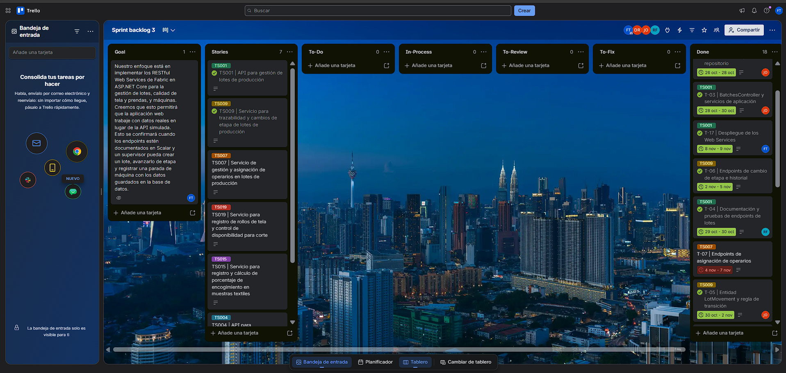

 

Link del tablero de Trello: [https://shorturl.at/IqitJ](https://shorturl.at/IqitJ)

#### 5.2.3.4. Development Evidence for Sprint Review

| **Repository** | **Branch** | **Commit Ids** | **Commit Message** | **Commit Message Body** | **Commited On (Date)** |
|----------------|------------|----------------|--------------------|-------------------------|------------------------|

#### 5.2.3.5. Execution Evidence for Sprint Review

#### 5.2.3.6. Services Documentation Evidence for Sprint Review

#### 5.2.3.7. Software Deployment Documentation Evidence for Sprint Review

#### 5.2.3.8. Team Collaboration Insights During Sprint

### 5.2.4. Sprint 4

#### 5.2.4.1. Sprint Planning 4

#### 5.2.4.2. Aspect Leaders and Collaborators

#### 5.2.4.3. Sprint Backlog 4

#### 5.2.4.4. Development Evidence for Sprint Review

#### 5.2.4.5. Execution Evidence for Sprint Review

#### 5.2.4.6. Services Documentation Evidence for Sprint Review

#### 5.2.4.7. Software Deployment Documentation Evidence for Sprint Review

#### 5.2.4.8. Team Collaboration Insights During Sprint

