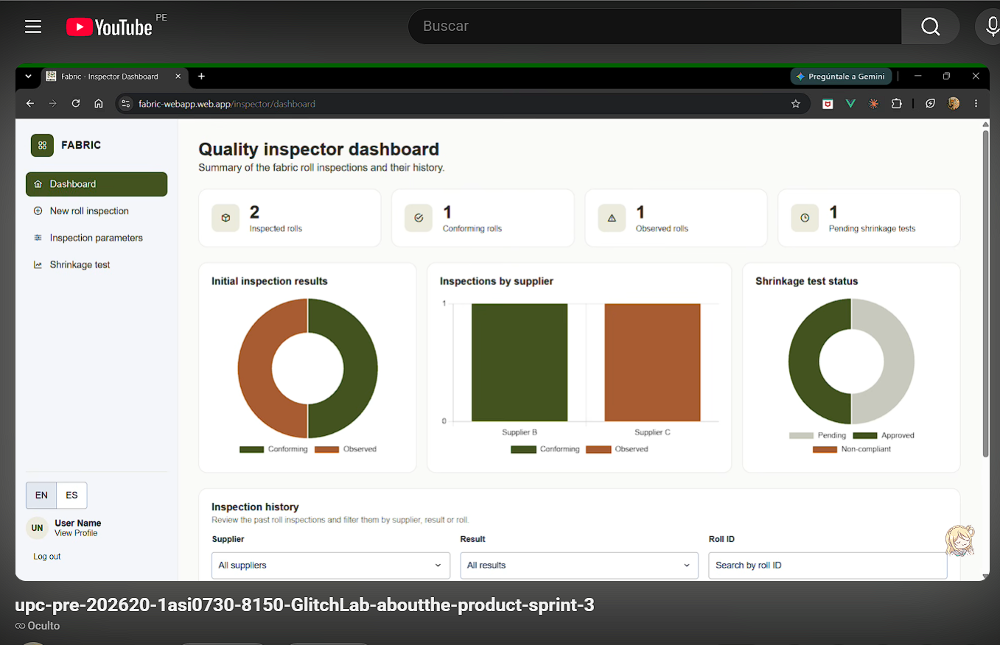

## 5.4. Video About the Product

El video *About the Product* presenta a Fabric, la plataforma web de GlitchLab para la gestión de producción, control de calidad y trazabilidad en MYPEs textiles de Lima (Gamarra). Está dirigido a los visitantes de la Landing Page y a los usuarios potenciales de la aplicación: supervisores de producción y encargados de control de calidad.

### Contenido del video

El video muestra:

- El problema que enfrentan las MYPEs textiles al registrar lotes, defectos y mantenimiento de forma manual o dispersa.
- El modelo de negocio de Fabric: planes Starter, Growth y Enterprise.
- Las funcionalidades y beneficios principales: gestión de lotes de producción, asignación de operarios, observaciones y trazabilidad, control de calidad (parámetros de inspección y prueba de encogimiento) y seguimiento de maquinaria.
- Escenas de interacción con la aplicación web, siguiendo los flujos de cada segmento objetivo.
- Una opinión positiva de un usuario por cada segmento objetivo (ver Testimonios).

### Enlaces

- **YouTube:** [Link Youtube](https://youtu.be/yFTNUzASp3c)
- **Microsoft Stream:** [Link Microsot Stream](https://upcedupe-my.sharepoint.com/:v:/g/personal/u202113310_upc_edu_pe/IQAbgrj0s-3pRaK5YrSAPRErAUfzzsT7n8epj3C3ssW01Hw?nav=eyJyZWZlcnJhbEluZm8iOnsicmVmZXJyYWxBcHAiOiJPbmVEcml2ZUZvckJ1c2luZXNzIiwicmVmZXJyYWxBcHBQbGF0Zm9ybSI6IldlYiIsInJlZmVycmFsTW9kZSI6InZpZXciLCJyZWZlcnJhbFZpZXciOiJNeUZpbGVzTGlua0NvcHkifX0&e=CH0vH3)
- **Duración:** 19:57
- **Nombre del archivo:** upc-pre-202620-1asi0730-8150-glitchlab-about-the-product-sprint-[PENDIENTE: n]

 

  

