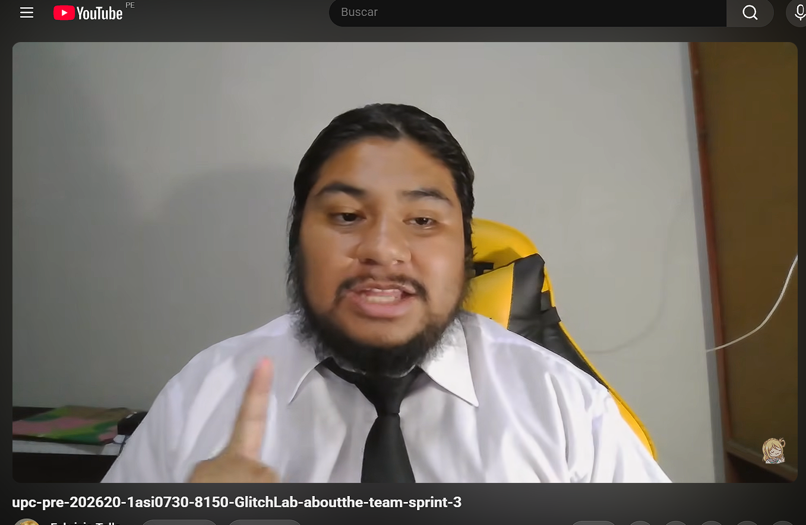

## Video About-The-Team

El video *About-The-Team* resume el proceso de trabajo que el equipo siguió para construir Fabric: desde el descubrimiento del problema en las MYPEs textiles de Lima hasta la implementación de la Landing Page, la aplicación web y el servicio RESTful.

### Enlaces

- **YouTube :** [Link Youtube](https://www.youtube.com/watch?v=spj55GCCFxk)
- **Microsoft Stream:** [Link Microsoft Stream](https://upcedupe-my.sharepoint.com/:v:/g/personal/u202113310_upc_edu_pe/IQBWJbhJh9hzTpFRN3ch95bIAdZQlLhwy5skqNIuESWEUqY?nav=eyJyZWZlcnJhbEluZm8iOnsicmVmZXJyYWxBcHAiOiJPbmVEcml2ZUZvckJ1c2luZXNzIiwicmVmZXJyYWxBcHBQbGF0Zm9ybSI6IldlYiIsInJlZmVycmFsTW9kZSI6InZpZXciLCJyZWZlcnJhbFZpZXciOiJNeUZpbGVzTGlua0NvcHkifX0&e=nDdmAi)
- **Nombre del archivo:** upc-pre-202620-1asi0730-8150-glitchlab-about-the-team-sprint-3
- **Duración total:** 10:01

 

  

### Pauta de secuencias de contenido

| Inicio (hh:mm:ss) | Sección | Descripción |
|---|---|---|
| 00:01 | Introducción al equipo y a Fabric | Explicacion sobre como propusimos la idea de desarrollar Fabric y el por que.|
| 00:44 | Proceso de trabajo | Mostramos algunas sesiones donde desarrollamos la landing page y frontend en las etapas iniciales del proyecto. |
| 03:12 | Retrospectiva del grupo | Una pequeña reflexión sobre lo que aprendimos como equipo y como afrontamos las dificultades que se presentaron durante el desarrollo del proyecto. |
| 09:33 | Testimonio de Tello Palacios, Fabrizio Rafael | Reflexión de lo que aprendió como Team Leader, estrategias que se siguieron para mejorar el desempeño del equipo durante cada entrega del trabajo y el aporte que dió al equipo para su correcto desarrollo. |
| 01:32 | Testimonio de Reátegui Galarcep, Diego Sebastián | Diego explica las tecnologías que uso para aportar al equipo durante el desarrollo de la aplicación, además explica su compromiso con el equipo y su proceso de mejora a lo largo del ciclo de desarrollo. |
| 03:07 | Testimonio de Estupiñan Olortegui, Juan Sebastian | Juan explica las dificultades que afrontó durante el proyecto y como el marco de trabajo SCRUM ayudó para mejorar la organización del equipo. |
| 06:23 | Testimonio de Flores Martinez, Ricardo Andres | Ricardo habla sobre el proyecto y como este ayudará a las personas que se dedican a la confección de textiles. Además, explica como mejoró su manera de organizarse para poder cumplir con las entregas del proyecto y lo que aprendió como personas para mejorar académicamente |

